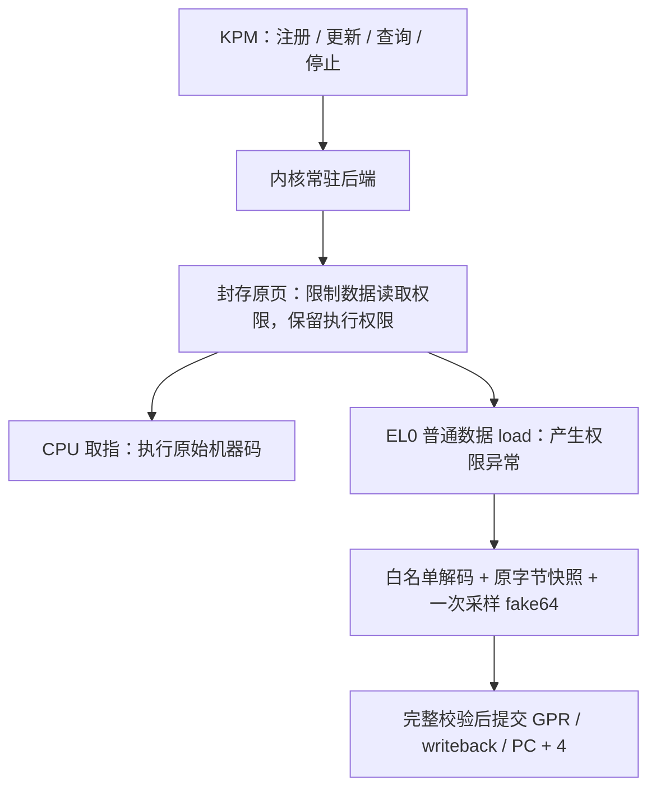

# 2026-11-03 代码交付说明

## 1. 实现原理

当前采用“**内核内置常驻后端 + KP 生命周期修复 + 薄 KPM**”。常驻后端持有页记录和异常处理代码；KPM 负责管理请求。这样已有异常不会跳入被卸载的 KPM text。



不改目标机器码，不在每次读取时临时开放页表，也不使用硬件断点或单步。注册和停止时修改权限并同步 TLB；更新覆盖值只发布一个对齐的 64 位原子值。

`native/urov.c` 只接管当前会话所属 mm、目标页内的 EL0 L3 读权限异常。translation/access-flag 等其他异常交原生路径处理。支持范围内的 load 从不可变快照和覆盖值合成结果；同一条 LDP 的两个结果使用同一次覆盖值采样。解码、地址、FAR、ESR 或上下文不满足要求时不部分更新寄存器；属于目标读权限异常但无法支持的指令向进程发 SIGSEGV。

页仍是原始物理内容。代码执行正常取指，读回的数据仅在异常模拟结果中改变。因此这不是直接写内存的同步读写 API。

## 2. 稳定性相关措施

### 后端

- 只允许调用者自身 mm、一个会话、一页恰好 4 KiB 的只读 sealed memfd RX VMA；要求不可写、不可改大小的完整 seals，排除 MTE、hugepage、userfaultfd 等情形。
- 注册时 pin 页并复制快照；写锁下重新检查 VMA/PTE，仅修改 `PTE_USER` 权限位，不回写过期 PFN、AF 或 dirty 位。
- MM 写锁下安装/恢复权限模板，原生集成点在变更前拒绝覆盖范围内的 `mprotect`、`munmap`、`mremap`、`madvise`、`mlock` 和 userfaultfd 注册/注销；活动 mm 暂停 VMA 合并。
- `VM_DONTCOPY` 禁止 fork 继承测试页。exec/exit 的 `exit_mmap` 集成在拆页表前撤销会话并排空 RCU reader。
- 长期只持 `mm_count`，不永久持 `mm_users`。管理清理临时获取 `mm_users`，在会话锁外 `mmput`，避免同步重入 exit_mmap 死锁。
- 正常停止先恢复权限、同步 TLB，再撤销记录并排空 reader。恢复失败保留会话、pin 和处理路径，供重试或 mm 退出清理。

### KP loader

- 注册表锁只保护查找、状态和每模块 busy 门；回调、分配、用户拷贝在锁外。
- ctl 的参数按调用独立分配。并发控制/事件与卸载争用返回 `-EBUSY`，调用方需重试。
- 同名模块在 init 前占用名称。init 失败且 cleanup 失败时保留可查询的实例，同时记录两个错误。
- 卸载先阻止新回调；已有回调未退出则返回忙。exit 失败转 `RETAINED`，只在 cleanup 成功后释放模块内存。
- `KPM_CONTEXT("sleepable-v2")` 明确允许新模块的 ctl/event 睡眠；没有该 metadata 的旧模块保持历史 RCU 回调上下文。未知 context 拒绝加载。
- 修正真实 `synchronize_rcu()` 包装，补充路径/参数截断、文件长度和读取检查；错误长度分支关闭文件，状态查询输出复制终止符并检查短拷贝。

这些是候选实现中的机制；host 检查不能证明它们已在真实内核的全部并发和 MM 路径上成立。

## 3. 控制协议

`urov_abi.h` 定义固定 128 字节请求。KPM ctl0 参数为 `"request"`，输出缓冲是明确约定的二进制 in/out 请求，不使用文本 ctl0 输出解析。后端只复制一次输入，返回后不保留用户地址。

| 操作 | 作用 |
|---|---|
| QUERY | 查询能力和自测就绪标志；不是会话状态查询 |
| REGISTER | 注册自身页；返回 session 与初始 generation=1 |
| SET | 检查 session、request_id、expected_generation 后原子更新覆盖值 |
| STATUS | 查询值、generation、状态、命中/失败计数 |
| DEACTIVATE | 恢复权限并排空；无会话时幂等返回 inactive |

未知版本、结构大小、flags 或非零 reserved 字段拒绝。输出拷贝失败可能发生在注册/更新提交之后：REGISTER 可按原 request_id 重试/找回状态，SET 支持最后一次相同请求的重试，过期 generation 返回 `-EAGAIN`。此受限版本没有单独的 RELEASE_HANDLE 或跨进程业务控制；持 KP 管理权限的卸载操作使用后端 DRAIN 清理。

`urov-lab.kpm` 强导入 `kpm_lifecycle_v2` 和 `kp_urov_backend_v1`。旧 KP 无法解析时在 init 前拒绝；修复后的 KP 若找不到内置 `urov_backend_v1`，初始化仍拒绝，不能只改版本号绕过。

loader 状态可通过 `kpatch <运行时凭据> kpm info urov-lab` 查询。`state=stopping` 时等待旧回调退出后重试卸载；`state=retained` 时检查 cleanup_errno 后重试卸载。不能把返回 EBUSY 当作可以释放模块的条件，也不要先加载同名实例。

## 4. 自验证程序到底测什么

`tests/urov_lab_test.c` 在自身 ELF `.text` 中定义两个独立汇编函数：

- subject：`BTI; MOV W0,#42; RET; NOP`。
- reader：`BTI; LDR X0,[X0]; RET; NOP`。

程序先用普通读取核对自身 ELF 的 subject 字节，并确认原函数返回 42；然后将相同代码复制到新的 sealed memfd 测试页，在只读 FD 上建立 RX 映射。**活动覆盖的对象是该专用页，不是 ELF 加载器创建的原始 `.text` VMA。** 这是当前页资格检查要求的受限实现。

完整模式将 offset 4 开始的 8 字节读回值在 `0x8877665544332211` 和 `0x1020304050607080` 间更新，检查普通 1/2/4/8 字节 load、16 字节 LDP、部分相交和非覆盖字节，同时执行原函数应一直返回 42。页内 reader 还检查 faulting PC 与被读地址同在保护页的情形。

线程在注册前创建，绑定允许的 CPU；开始更新前检查各线程已有读取进展。检查代次冲突、MM 操作 EBUSY、停止后原始读取、卸载完成后，才输出 `scope=active_overlay` 的 PASS。

`--text-only` 只验证代码字节及原始执行，明确输出 `overlay=NOT_ENABLED`。当前真机只通过此基线，完整活动模式没有通过。

## 5. 构建与源码集成

### KPM / Android 程序

在 KernelPatch 根目录执行：

```powershell
./kpms/urov-lab/build.ps1 -Ndk D:\androidSDK\ndk\26.1.10909125
wsl -d Ubuntu-24.04 bash kpms/urov-lab/tools/test_host.sh
```

KPM 使用 freestanding AArch64，异常相关核心使用 general regs only；Android 程序使用 API 31、PIE、pthread。`out/urov-lab-check.kpm` 是不安装异常入口的预检模块，不能与活动模块混称。

### KP 核心

本轮使用 WSL Ubuntu-24.04 的 GCC 交叉工具链完成 `kpimg` 链接；命令如下，仅生成 KP 核心产物：

```sh
make -B -C kernel TARGET_COMPILE=aarch64-linux-gnu- ANDROID=1 \
  CFLAGS="-Wall -fno-builtin -std=gnu11 -nostdinc -mgeneral-regs-only -ffixed-x18 -fno-stack-protector -fno-pie -fno-pic -fno-asynchronous-unwind-tables -fno-unwind-tables -DANDROID" \
  -j4 kpimg
```

### 内核内置后端

后续获得启动环境变更授权并通过基线后，应在真实、完整、匹配的内核 Git checkout 中运行：

```sh
python /absolute/KernelPatch/kpms/urov-lab/tools/prepare_native.py /absolute/android-kernel
```

脚本要求 HEAD 前缀 `66e758f7d0c0`，先检查全部源码锚点，再复制后端和增加 MM/fault 集成。已有不同后端文件会拒绝覆盖。配置 `CONFIG_UROV_LAB=y`，再按该 Android 内核的标准工具链和 Kbuild/Kleaf 流程完成配置、全量编译与链接；该后端是 bool 内置，不生成可插拔 `.ko`。

当前 Pixel 6 没有 EPAN。只有内核显式配置 `CONFIG_UROV_LAB_RAW_XOM=y` 且注册请求显式设置 `UROV_F_RAW_XOM` 才能尝试 raw-XOM。它使该映射失去 PAN 的内核读取隔离，属于实验配置；不能宣称保留了等价的生产隔离。

本轮仅利用精确 commit 的头文件和设备配置重建的 generated headers 编译四个对象，保留 KCFI/SCS。源码集成锚点在逐文件取得的匹配源码副本验证过；该副本没有完整 Git 元数据，也不是一次真实完整内核构建。详见当前结果记录。

## 6. 设备验证入口

```powershell
python kpms/urov-lab/tools/device_test.py --serial 25091FDF60063J
```

脚本运行时读取凭据，上传四个产物到独立目录并对照 SHA256，依次跑 shell/root 复制、SIMD 和 root 自身代码基线。基线任一失败，返回 `3 / BLOCKED_BASELINE`，不进入活动测试。

后续已启动合格内核的环境才使用 `--activate`；raw-XOM 还需显式加 `--allow-raw-xom`。脚本不会准备镜像、重启或刷写；设备命令有 60 秒限制，ADB 外层有 75 秒限制。保留 JSON 报告及前后 boot_id/模块列表；没有自动卸载其他实例或自动清理状态不明的会话。

`--key-fd FD` 可代替交互输入；凭据不写入报告、文件或主机命令参数。现有设备 kpatch CLI 的接口要求它在设备侧短暂出现在 argv 中；本实现不声称消除了这一限制。

## 7. 尚待验收的边界

当前不支持任意进程、任意代码 VMA、多页/多会话、SIMD/FP load、acquire/exclusive、跨页 load、MTE 或完整 debug/single-step 语义。被保护页上的通用 libc 读取可能使用不支持的指令并收到 SIGSEGV。

完整内核构建/链接、启动、真实 fault 覆盖、恢复失败注入、MM 并发压力、fork/exec/exit 全场景、KASAN/KCSAN/lockdep、长时运行和性能验收尚未完成。不能由本轮编译和软件模拟 PASS 推出“实际活动覆盖稳定可用”。本次用户选择先交付代码及当前结果，未继续准备启动镜像。
