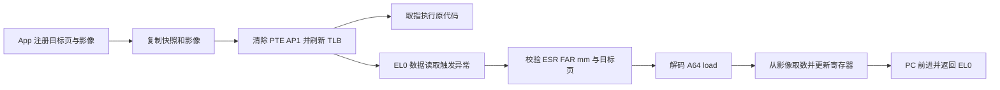

# UROV-Z 1.0.0 — 原理与实现 / Design and implementation

## 中文

### 1. 目标与边界

UROV-Z 为 Android AArch64 提供代码页读取覆盖实验：目标页的指令仍从原映射执行，受支持的数据读取返回另外注册的页影像。唯一后端为 **PAGE_AP**，唯一读取策略为 **all-callers**。既不提供 BRK/UXN 后端，也没有 reader-site / caller 白名单、模式切换或调用栈授权。

all-callers 的准确含义是：对会话所覆盖地址空间与目标页内的受支持读取，不检查读取指令的 PC、LR 或调用者身份。它不表示系统中任意别名、任意设备 DMA、任意内核读取接口都被覆盖。会话控制仍要求模块密钥和 owner mm；fork 子进程的影像继承有明确限制。

本版本是实验模块，优先验证文件映射中保持 RX 的 `.text` 页。内核版本号只是第一层筛选；运行时结构布局、函数签名、页表几何、可选 hook 是否成立共同决定可用能力。未在设备上运行的内核不能仅凭编译或 BTF 检查宣称稳定兼容。

### 2. 对 UROV-Y 的分析与取舍

分析基线是独立仓库 `dev` 的 `3679b4f`，UROV-Y 2.28.0。旧源码保留在 Git 历史；本分支工作树仅交付 Z。

| Y 的组成 | 实际职责 | Z 的处理 |
|---|---|---|
| `urov_y.c` | KPM 元数据、init/ctl0/exit | 改为 `module/urov_z.c`，新名称与版本 |
| `urov_y_backend.c` | 多种陷阱、会话、页表、异常模拟、GUP、生命周期 | 提取 PAGE_AP 路径，删除其他后端与 caller 策略 |
| `urov_y_abi.h` | 多模式控制与页描述符 | 独立 ABI v1，184 字节请求；没有 mode/sites/callers |
| `urov_y_compat.h` 与 BTF reader | 动态成员偏移、函数原型和页大小 | 保留运行时适配；使用模块本地头文件 |
| decode/emulate/selftest | A64 解码与寄存器效果模型 | 保留通用核心，自检 4152 项 |
| readers/window/prewin | 双 epoch 引用与独占指令窗口模型 | 保留；这里的 window 指 LL/SC 指令窗口，并非 caller-window 模式 |
| X 的认证辅助函数 | SipHash-2-4 与密钥派生 | 使用独立 `UROVZ/1` 派生域 |

Z 同时修正了若干与所保留路径直接相关的问题：

1. `process_vm_readv` 不再存在重读用户 iovec 后改写目的缓冲区的兼容路径。使用独立 order-0 影像页和 Linux grab/unpin helper，读者引用覆盖整个 syscall。
2. 内部 `access_remote_vm` 抑制标记改为按 task 占用的槽位，避免多个线程覆盖单个全局指针。
3. fork 对每个子进程保留一个 mm 引用；复制时建立影像快照、主动 fault-in 并重新设置 AP。仅依赖父 PTE 复制不可靠：Linux 可跳过文件页的页表复制。[Linux 6.1 `copy_page_range`](https://raw.githubusercontent.com/torvalds/linux/v6.1/mm/memory.c)
4. clone 与控制事务串行化。容量不足返回 `ENOSPC`；无可用 `copy_mm` hook 时拒绝非共享 mm 的 clone；已继承快照的子进程再 fork 返回 `EOPNOTSUPP`。存在存活子快照时注销返回 `EBUSY`。
5. 映射 syscall 的修改与 after-hook 更新使用同一个控制事务；在 native syscall 前等待控制锁，不向普通 libc `mprotect` 注入瞬时 `EBUSY`。
6. rwsem 回退统一通过正确的 `mm + mmap_lock_offset` 包装函数；陷阱修复检查 VMA 可读性；子 mm 的 fault-rearm 持有读者引用。
7. FOLL 标志优先读取 BTF，pin helper 的 bool/int 返回类型分别处理。用于页替换的临时页以非阻塞、零 GFP mask 分配，避免假定跨版本的 `GFP_ATOMIC` 位组合。

### 3. PAGE_AP 的工作过程

ARM64 普通 stage-1 leaf PTE 中，Linux 的 `PTE_USER` 对应 AP[1]；它参与 EL0 数据访问权限检查。注册时验证可读可执行、非 writable 的普通文件页，并清除 AP[1]，保持输出物理页与执行权限。EL0 仍执行原始指令，数据读取发生 permission fault。相关位定义及 execute-only 编码见 [Linux ARM64 pgtable-prot.h](https://raw.githubusercontent.com/torvalds/linux/v5.4/arch/arm64/include/asm/pgtable-prot.h)。

`do_mem_abort` before-hook 只接管 AArch64 EL0 的 data abort（EC=0x24）、level-3 permission fault（FSC=0x0f），排除无效 FAR、页表遍历、外部异常及未知 ISS2 情况。地址必须落在会话覆盖范围。其他异常交还 Linux。[Linux 6.1 ARM64 fault.c](https://raw.githubusercontent.com/torvalds/linux/v6.1/arch/arm64/mm/fault.c)

对已支持的 load，先计算有效地址、长度和 writeback，再按页切分访问。覆盖页读影像；未覆盖片段通过 nofault uaccess 获取。只有模拟成功才提交目标 GPR、SP/writeback 和 PC。读取指令本身位于目标页时，从 native snapshot 解码该指令，而非从替代影像取操作码。无法可靠模拟时计入 failures 并产生 SIGSEGV，不把任意未知指令直接当作成功。

标量支持由通用解码器覆盖的大小、符号扩展、寄存器/立即数寻址、pair、literal、非特权 load 等形式。向量路径处理支持的 SIMD load、LDR Q 和 LD1–LD4 结构访问，最大一次解码访问 64 字节。其 FPSIMD 数据结构和保存/恢复 helper 必须经过 BTF 验证；活动 SVE/SME 等不受支持状态不会被当作普通 FPSIMD 随意覆盖。能力以 QUERY 返回值为准。

不在注册时改写代码字节，不以 UXN 禁止执行，不插入 BRK。后端中的 debug exception / `__switch_to` hook 用于可选的原生单步重放，属于 PAGE_AP 的写入/独占指令辅助路径。

### 4. 会话、影像和并发

全局最多一个会话；owner 为注册线程的 mm，线程组 ID 用于区分 owner exec 与 vfork child exec。会话 ID 固定为 1，初始 generation 为 1。其他 mm 无权 SET 或 DEACTIVATE；QUERY/STATUS 的会话视图是调用者局部的，`ctl0 status` 才是全局状态。

每页保留 7 页主存储：当前 image、备用 spare、native snapshot、原生重放 pre/post、外部写入 pre/drain。影像覆盖窗口以外的内容来自 snapshot；注册按地址排序，但保存原输入描述符序号，SET_PAGE 仍使用该序号。

`readers.h` 将 open/closed、当前 epoch、两个引用计数放入同一 64 位原子字。SET 在 spare 中准备完整新影像，原子交换 image，翻转 epoch，等待旧 epoch 的读者离开，才回收旧 image 为 spare。这保护 image 的内存生命周期，防止读者使用已经重用的缓冲区。一次多指令 memcpy 或多个页的读取没有跨所有指令的统一 generation 快照保证。

`process_vm_readv` before-hook 为当前 task 建立有界槽位并持有 session reader；after-hook 释放它。独立 pin 替换页在 native syscall 自己的 unpin 流程中回收，模块的 SET/注销不会提前释放 syscall 正在读取的来源。

控制请求、映射事务与 fork 使用控制锁协调。直接读取不获取控制锁；映射 syscall 在进入 native 函数前等待控制事务完成。REGISTRATION 先提供 snapshot replay，再逐页 arm，全部成功后启用替代值；失败进入恢复流程。

主影像预算默认 8 MiB，实际最大页数为 `min(max_pages, max_kb*1024/(7*page_size))`：默认 4 KB 时 292 页，16 KB 时 73 页。fork 池按 `4*page_count` 个槽预留，每槽 2 页，受 4096 槽及 16 MiB 上限限制；它不是整个模块总内存限制。LL/SC 的分支图另有最多 24 MiB arena、1024 个区域和扫描工作量限制。

### 5. 内核辅助读取

这些接口可能绕过 EL0 异常，分别由可选 hook 覆盖。功能缺失应检查 capability 并跳过相应测试，不能把 native 返回值误认成影像。

| 路径 | 实现与限制 |
|---|---|
| `/proc/<pid>/mem`、使用相同 helper 的 ptrace | hook `__access_remote_vm` / `access_remote_vm`，仅覆盖 Linux 已允许且实际成功读取的范围；模块内部读取通过 task 槽位排除 |
| `process_vm_readv` | hook syscall 和 `pin_user_pages_remote`；在已成功 pin 的源页数组中，以独立影像页替换目标页；保持 Linux 原本的权限检查和目的 iovec 导入逻辑 |
| `vmsplice` 等普通 fast-GUP 读者 | hook `get_user_pages_fast`，为受支持读路径提供独立、普通引用计数影像页 |
| 写 GUP / slow GUP | 保留 native 写入/COW，尝试捕获并同步写后数据和重新 arm；不将长期 pin 转换成临时影像页 |

pin 替换用 `try_grab_page` 的正确 bool/int 约定以及 `unpin_user_page`；不能通过硬编码修改 `struct page` 引用计数来代替 Linux helper。新旧 FOLL 编码及 pin 类型有差异，参考 [Linux 6.1 gup.c](https://raw.githubusercontent.com/torvalds/linux/v6.1/mm/gup.c)、[Linux 6.6 gup.c](https://raw.githubusercontent.com/torvalds/linux/v6.6/mm/gup.c)。BTF 未提供可用签名或必要 helper 缺失时不报告 READV 能力；不存在目的缓冲区重写回退。

### 6. 映射和退出生命周期

- `mprotect`/`pkey_mprotect`：Linux 先完成原始权限变更；after-hook 更新 want/armed，并在仍可读的页上重新设置 AP。PROT_NONE 暂停该页；execute-only 不被假定为可读。
- `MADV_DONTNEED` / fault-in：`handle_mm_fault` before-hook 保存仍有效的 VMA 身份，after-hook 排除 ERROR/RETRY/COMPLETED 再 rearm。不能假定返回后原 VMA 指针仍有效。
- `munmap`/`MAP_FIXED`/`mremap`：成功后更新目标范围或标记 gone；失败 syscall 不应错误结束会话。复杂并发迁移仍受第 10 节限制。
- fork：父进程的每页影像在 copy_mm 后快照到子 mm 私有池；保留 mm 引用，主动填充子 PTE，避免只靠父 PTE 继承。父 SET 不更新子快照。子进程再 fork 被拒绝，共享 mm 的线程不占新快照。
- 退出/exec：死 owner 的会话在下次认证控制调用时回收；存活子快照会阻止回收。成功注销必须先等待原生重放结束、停止 rearm、恢复 owner 页 AP、广播 TLBI、关闭并清空读者，再释放影像与 mm 引用。

fork 槽在本会话内不循环复用；持续 fork 应分批创建新会话。子进程在注销前必须退出或 exec。fork 初始化中的资源/映射失败可设置 degraded，不能把此类情况视为可靠继承。REGISTER/SET 的用户缓冲区在操作结束前应保持稳定。

### 7. ABI v1

头文件 [module/abi.h](module/abi.h) 为唯一线格式定义：小端 AArch64，自然 8 字节对齐，184 字节请求、32 字节页描述符，编译期静态断言大小。它与 UROV-Y ABI 不兼容。

传输为 `syscall(__NR_prctl, option, magic, op, &request, sizeof(request))`。option 为 `uz_derive` 得到的低 32 位，magic 固定为 `0x42414c5a564f5255`（小端 “UROVZLAB”）。用派生 MAC key 对前 176 字节计算 SipHash-2-4。错误 option/magic/size/version/op/MAC 不会执行控制操作，交还原始 prctl，通常得到 EINVAL。

| 偏移 | 字段 | 含义 |
|---:|---|---|
| 0 / 4 / 6 | size:u32 / version:u16 / op:u16 | 必须为 184 / 1 / 操作号 |
| 8 | request_id:u64 | 调用方关联值，原样保留；不是防重放 nonce |
| 16 / 24 / 32 | session / address / expected_generation | 会话号、单页注册基址、SET 的预期版本 |
| 40 / 48 / 52 / 56 | value / offset:u32 / length:u32 / value_hi[3] | 内联影像、窗口参数，总计最多 32 字节内联 |
| 80 / 88 / 92 | generation / state:u32 / last_error:s32 | 版本、状态；last_error 保留，错误以 syscall 返回值为准 |
| 96 / 104 / 112 | hits / replays / failures | 统计字段 |
| 120 / 128 / 136 | flags / fake_addr / reserved | flags 输入为 0；用户影像指针；SET_PAGE 的输入索引或 STATUS 的输出 armed 数 |
| 144 / 148 / 152 | page_count:u32 / page_stride:u32 / pages_addr | 页描述数组；QUERY 中 stride 为 page_shift |
| 160 / 168 / 176 | session_flags / reserved2 / mac | capabilities 输出、保留零字段、请求 MAC |

操作如下；每次构造新的零初始化请求，重新计算 MAC，不要直接重用包含输出 capability 的旧请求：

| op | 操作 | 输入 / 结果 |
|---:|---|---|
| 1 | QUERY | 返回最大页数、page_shift、capabilities；也触发死 owner 回收 |
| 2 | REGISTER | `page_count>0` 使用描述数组，stride=32；count=0 使用 address/offset/length 与内联 value 或 fake_addr |
| 3 | SET | 仅单页会话；session=1，expected_generation 必须匹配，保持原覆盖窗口长度 |
| 4 | STATUS | session=1 查询调用者会话；reserved 输出 armed 页数 |
| 5 | DEACTIVATE | session=0 或 1；owner 执行，空会话幂等；存活 child / 未完成 replay 返回 EBUSY |
| 6 | SET_PAGE | session=1、expected_generation、reserved=原描述符索引、offset/length/fake_addr |

页描述符为 `base:u64, fake_addr:u64, fake_off:u32, fake_len:u32, flags:u32, reserved:u32`。base 按运行时页大小对齐；flags 仅允许 SRC_USER=1；reserved=0；窗口长度为 8 的正整数倍且不超过页，`fake_len=0` 表示整页。偏移只须保证窗口不越界。单页内联形式 `length=0` 则表示 8 字节；超过 32 字节必须传用户缓冲区。

capability：MULTI=0x1、LD1/2/3/4=0x2/4/8/10、CROSS=0x20、16K=0x80、PAGE_AP=0x400、REMOTE_VM=0x800、READV=0x1000、GUP=0x2000、STEP=0x4000、FORK_SNAPSHOT=0x8000（均为十六进制）。没有 capability 表示旧模式或 caller 过滤。

常见错误：EINVAL 参数/范围不合法；EFAULT 用户缓冲区访问失败；ENOENT 非 owner/会话无效；EAGAIN generation 冲突或暂时无 PTE；EBUSY 控制事务/child/replay 未结束；ENOMEM 内存不足；ENOSPC fork 快照容量不足；EOPNOTSUPP 缺少必要内核能力。

输出写回前先进行可写性探测，避免常见的“执行后才发现结果不可写”。但用户映射仍可能并发改变，最后写回 EFAULT 不能证明操作没有提交：停止并发映射变化，用 STATUS 重新同步。返回结构的 MAC 不重新签名，不能作为认证响应使用。密钥也不是对 root 的安全边界，kpatch 可记录加载参数；不要把测试密钥写入源码。

### 8. 5.x / 6.x 兼容策略

| 项目 | 适配策略 |
|---|---|
| 版本范围 | 当前明确接受 5.4 ≤ kernel < 7.0；不保证所有厂商 backport |
| 结构偏移 | 从当前 BTF 解析 task/mm/VMA/FPSIMD/pt_regs，检查成员大小与范围；不用固定机型偏移 |
| MM fault | 识别 3 参数旧版、4 参数新版、5 参数 vendor 内部入口；无公开原型时，仅对已知公共 ABI 使用保守包装 |
| access_remote_vm | 5 参数公共入口 / 6 参数内部入口，按 BTF 选择 |
| mmap 锁 | mmap helper 或动态 mmap_lock/mmap_sem 偏移加 down_write/up_write |
| nofault uaccess | copy_*_user_nofault 或 probe_user_*；睡眠控制路径允许访问 helper 回退 |
| 分配与 FPSIMD | 解析常见及 `_noprof` 分配符号；适配不同 FPSIMD save helper |
| 页表 | TCR_EL1 检查 4 KB / 16 KB、VA 范围与遍历深度；拒绝 64 KB、LPA2、不匹配深度及不兼容 TCR2 扩展 |
| 目标叶子 | 拒绝 block、contiguous、special、devmap、PROT_NONE 等不能安全单页操作的形态 |

旧 5.x 如没有内置 BTF，需要提供该设备**同一内核构建**的外置 BTF。包格式为 80 字节头（8 字节 `UZBTF01\0`、u32 BTF 长度、u32 Build ID 长度、64 字节 Build ID）加原始 BTF，最大 64 MiB。加载时和运行内核 notes 的 GNU Build ID 匹配后再解析。ID 是匹配检查，不是签名；必须信任本机提供的 BTF 文件。

测试 SO 的最大 ELF segment alignment 设置为 16384，fixture 按 16 KB 对齐、保留 32 KB 空间，测试长度使用 `sysconf(_SC_PAGESIZE)`。这提供 16 KB 构建条件，不能代替 16 KB 设备测试。[Android 16 KB page-size guidance](https://source.android.com/docs/core/architecture/16kb-page-size/16kb)

### 9. 实际验证记录（2026-11-11）

设备 Pixel 6/oriole，API 36，内核 `6.1.134-android14-11-g66e758f7d0c0-ab13748739`，4 KB，KernelPatch c00。App UID 10286，在 `untrusted_app` 域运行。设备自身时钟与主机日期不同，因此记录以本次工作日期为准。

| 验证 | 结果 |
|---|---|
| KPM 严格 ARM64 编译 | `-Wall -Wextra -Werror` 通过，AArch64 ELF REL |
| 模块核心自检 | 4152 项通过 |
| App 基线 | 5 项通过，原函数返回 1235，原数据 0x11 |
| App 完整测试 | 49 项通过，失败 0；内部 BTF 与外置 BTF 路径均运行过 |
| 最终外置 BTF 轮次并发 | 48 次 SET_PAGE，421594 次 worker 读取，torn_or_failed=0 |
| 最终轮次 STATUS | generation=50，hits=422503，replays=0，failures=0 |
| 错误 Build ID | 加载被拒绝，日志为 header/build ID mismatch |
| 错误模块密钥 | QUERY 返回 EINVAL，无控制操作 |
| 注销、卸载、再基线 | inactive / pages=0 / armed=0；卸载后 5 项基线通过，boot ID 未改变 |

49 项包含：原代码执行、独立读取者和页内读取者、两页与跨页 LDP、FPSIMD/LD2/LD4、memcpy/memcmp/strlen/CRC、proc mem/readv/vmsplice、重复/越界描述符拒绝、generation 冲突、并发影像更新、mprotect、丢弃 PTE 后 rearm、fork 快照隔离、存活子进程阻止注销、子进程再次 fork 拒绝，以及内联 REGISTER/SET 与注销恢复。

`app/compat_check.c` 另检查合成 3/4/5 参数 ABI、错误原型、FOLL 值冲突、外置 BTF 错误包、页表几何。保存的真实 BTF 检查通过：5.15.74（vendor `do_handle_mm_fault/5`）、6.1.134、GKI 6.12、GKI 6.18、GKI 6.18 16 KB。后三者及 5.15 **没有在相应内核启动运行本模块**；5.4 仅有 ABI 适配/合成检查。

测试期间修正了 App tagged heap pointer 导致注册失败、子进程文件页未 arm，以及过于宽泛的映射 EBUSY 导致 libc abort；最终结果取修正后的回归。内核日志还存在一次 `pci_pm_suspend` 的 WARN，不在 urov-z 调用栈；不能把整个测试期间描述为零内核告警。没有观察到本模块引起的内核 Oops 或设备重启。

### 10. 明确限制与后续验证条件

1. **页表锁**：当前继承 Y 的页表遍历、CAS、mmap 锁/RCU 与 TLBI 方案，没有在每次 leaf 访问中获取 Linux 原生 split PTE lock。CAS 防止覆盖新值并不构成完整 MM 并发证明；不能宣称对 reclaim、迁移、页表回收和 per-VMA 锁并发安全。升级为可生产使用的实现，应增加经目标内核验证的 native PTL 路径与压力测试。[Linux split page table lock](https://docs.kernel.org/6.6/mm/split_page_table_lock.html)
2. **写入与原子**：标量/向量 store、LSE、LL/SC 和 native replay 是继承的辅助机制。页影像就地写入的 sequence 重试有上限，fallback 与并发 native write 仍可能撕裂；外部写入同步不是任意内核 writer 的线性化事务。当前 App 没有覆盖这些机制的所有指令或竞争。
3. **LL/SC 不能完全透明**：异常可能破坏独占监视器。前向/反向窗口、分支图和单步无法重建任意真实执行历史、间接跳转及其他 CPU 的 reservation 竞争，因此可能有额外失败或不符合原生历史的成功。保持 RX、避免在独占序列中读取覆盖页是本次验证范围。
4. **原生重放与映射变化**：单步重放临时恢复 AP，其他线程可能观察到原始值；不同页/不同指令不保证同一代影像。并发 mremap、munmap、权限变化与读取未获得完整形式化或压力验证；调用方应静止相关读者后进行复杂映射修改。
5. **覆盖范围**：文件的新别名、直接读磁盘、DMA/长期 pin、未 hook 的内核读取路径、AArch32、MTE/tagged ABI 指针、SVE/SME 负载均不在已验证保证内。PAGE_AP 的异常开销与内核状态可被观察，不提供“不可检测”保证。
6. **卸载约束**：旧 KernelPatch loader 可能在 RCU read section 内调用 exit，且不可靠地尊重 exit 错误；本模块的 `sleepable-v2` 元数据不能改造旧 loader。必须在 sleepable owner 控制路径完成 DEACTIVATE、确认全局 inactive 后卸载。[KernelPatch 0.12.0 module loader](https://raw.githubusercontent.com/bmax121/KernelPatch/0.12.0/kernel/patch/module/module.c)

## English

### 1. Purpose and scope

UROV-Z is an Android AArch64 code-page read-overlay experiment. Original instructions execute from their existing mappings; supported data reads receive a separately registered image. **PAGE_AP and all-callers are the only backend and read policy.** The source contains no BRK/UXN backend, reader-site registration, caller allowlist or mode switch.

All-callers means that a supported read of a covered page is not filtered by its PC, LR or calling function. It does not cover every alias, DMA engine or kernel interface. Control operations still authenticate the module key and owner mm. Fork inheritance is bounded and explicitly managed.

The validated use case is ordinary file-backed `.text` remaining RX. Kernel version alone is insufficient: BTF layouts, function signatures, translation geometry and available hooks determine compatibility. Static checks are not runtime certification.

### 2. Relationship to UROV-Y

The reference is UROV-Y 2.28.0 at `dev:3679b4f`. Z extracts the PAGE_AP path from `urov_y_backend.c`; removes the other trap backends and caller policy; retains the common A64 decoder/emulator, 4152-check selftest, epoch reader lifetime mechanism and LL/SC instruction-window helpers. The latter windows are instruction analysis, not caller filtering. KPM metadata now lives in `module/urov_z.c`. Authentication is adapted from X with a separate `UROVZ/1` derivation domain. The new 184-byte ABI v1 is deliberately independent of Y.

Relevant corrections include independent pin replacement pages instead of a destination-iovec rewrite fallback; syscall-wide reader references; task-specific internal-access markers; referenced child mm snapshots and explicit child PTE population; guarded clone lifetime; mapping transactions serialized with control updates; correct rwsem offset fallback; VMA readability checks before trap repair; and BTF-aware FOLL/helper conventions. Temporary replacement pages use a zero, nonblocking GFP mask rather than assuming the same GFP_ATOMIC bit pattern on every kernel.

Linux may skip copying page tables for file-backed mappings at fork. Consequently, inheriting a parent's modified PTE is insufficient; the copy_mm hook populates and arms the child before it can run. See the linked Linux `copy_page_range` source in the Chinese implementation analysis.

### 3. Permission-fault read path

For supported ARM64 stage-1 leaf PTEs, Linux `PTE_USER` is AP[1]. Registration validates the RX file mapping and clears that bit while preserving the output page and execution permission. Instruction fetch continues normally; EL0 data access raises a permission fault. The diagram above shows registration, fault decoding and register commit.

The `do_mem_abort` before-hook accepts AArch64 EL0 data aborts with EC 0x24 and level-3 permission FSC 0x0f. It excludes invalid FAR, stage-1 walk, external-abort and unsupported extended-syndrome cases. Other exceptions remain native.

The decoder computes the effective address, width and writeback. A read spanning pages is split: covered portions come from images and uncovered portions use nofault uaccess. Destination GPRs, SP/writeback and PC are committed only after successful emulation. If the reader instruction itself lies in a target page, its opcode comes from the native snapshot. Unsupported emulation records a failure and raises SIGSEGV instead of fabricating success.

Scalar forms include supported immediate/register addressing, sign extension, pair/literal and unprivileged loads. Supported SIMD paths include LDR Q and LD1–LD4 structures, with a maximum decoded access of 64 bytes. FPSIMD layout and save/update helpers must be validated. Unsupported active SVE/SME state is not treated as ordinary FPSIMD. QUERY reports the usable capabilities.

Registration does not patch code bytes, set UXN or insert BRK. Optional debug-exception and context-switch hooks support PAGE_AP native single-step replay for writes/exclusive sequences.

### 4. Session and publication model

There is one global session. Its owner is the registering mm; its thread-group ID distinguishes owner exec from a vfork child's exec. Session ID is 1 and generation starts at 1. Foreign address spaces cannot SET or DEACTIVATE it. QUERY/STATUS are caller-local; `ctl0 status` reports global state.

Each descriptor allocates seven main pages: image, spare, native snapshot, replay pre/post, and external-writer pre/drain buffers. Bytes outside the overlay window originate from the snapshot. Descriptors are sorted by address while preserving their original input index for SET_PAGE.

One atomic 64-bit word holds a closed bit, an epoch bit and two reader counters. SET prepares a complete spare image, atomically publishes it, flips epochs and waits for old readers before reusing the former image. This protects buffer lifetime. It does not make every instruction of a large memcpy, or every page in an operation, observe one generation.

The readv syscall retains a reader reference from before-hook through after-hook. Its replacement source pages are separately allocated and released by the native unpin flow. SET and deactivation cannot reclaim the source images underneath that syscall.

Control operations, mapping transactions and non-shared-mm forks are serialized. Direct loads use reader references rather than the control lock. Mapping syscalls wait before native execution, avoiding unexpected mprotect EBUSY in libc. Registration first exposes snapshot replay, arms every page, then enables the image; failure invokes restoration.

The default main pool is 8 MiB. Effective capacity is `min(max_pages, max_kb*1024/(7*page_size))`: 292 pages at 4 KB or 73 at 16 KB. A child snapshot consumes two pages per descriptor. The pool starts with four descriptor sets, capped at 4096 slots and 16 MiB. A separate LL/SC branch-map arena can reach 24 MiB with 1024 regions and bounded scans; `max_kb` is not a total memory limit.

### 5. Kernel-assisted reads

Optional hooks cover paths that bypass the EL0 exception:

| Path | Mechanism |
|---|---|
| proc mem and consumers of remote-VM helpers | Overlay the successfully authorized, returned range in `__access_remote_vm`/`access_remote_vm`; exclude module-internal snapshots |
| process_vm_readv | Retain a syscall reader reference and replace successfully pinned source pages in `pin_user_pages_remote`; leave native access checks and imported destination iovecs intact |
| vmsplice / ordinary fast GUP | Return independent image pages with ordinary page references for supported read calls |
| Write / slow GUP | Keep native COW/write behavior and attempt image synchronization/rearming; do not turn long-term pins into temporary overlays |

The pin path uses the correct bool or int return convention of `try_grab_page` and Linux's `unpin_user_page`. It does not patch raw page reference counts. Missing helpers/signatures disable READV capability; there is no destination-buffer rewrite fallback. The Linux GUP sources linked above show the version-dependent conventions.

### 6. Mapping and child lifetime

Successful mprotect/pkey_mprotect calls update the page's desired and armed state; readable mappings are rearmed, PROT_NONE is suspended and execute-only is not assumed readable. The MM fault before-hook captures VMA identity before Linux may invalidate the pointer; the after-hook excludes incomplete/error returns before rearming. Successful unmap, fixed replacement and remap update or retire the relevant descriptors. Complex concurrent mapping changes remain subject to the limitations below.

copy_mm snapshots each child's images, retains one mm reference, populates its PTEs and installs AP traps before the child runs. Parent SET does not alter the child snapshot. Shared-mm threads need no snapshot. A snapshot child cannot create another independent mm through fork; it receives EOPNOTSUPP. Exhausted fork capacity returns ENOSPC. Slots are retained until the session ends, so repeated fork workloads should use bounded batches.

DEACTIVATE returns EBUSY while a retained child mm still has users or native replay cannot quiesce. Let children exit or exec first. Dead-owner cleanup occurs on the next authenticated control call. Successful release stops rearm, restores owner AP bits, broadcasts TLBI, closes and drains readers, then frees images and mm references. Fork setup resource/mapping failures may set degraded and are not certified as successful inheritance. Keep user request/image buffers stable until the operation completes.

### 7. Wire protocol

`module/abi.h` defines the little-endian, naturally aligned AArch64 ABI: request 184 bytes, descriptor 32 bytes, enforced by static assertions. It is not wire-compatible with Y. Transport is `syscall(__NR_prctl, option, magic, op, &request, sizeof(request))`; option is the derived low 32-bit value, magic is fixed `0x42414c5a564f5255`, and SipHash authenticates the first 176 request bytes. Invalid transport/authentication is passed to native prctl, normally returning EINVAL.

The offset table above is normative for both language sections. In particular:

- size/version/op are at 0/4/6; request_id at 8 is an echoed correlation value, not replay protection.
- session/address/expected_generation occupy 16/24/32. Inline value, offset, length and value_hi begin at 40/48/52/56.
- generation/state/last_error occupy 80/88/92. last_error is reserved; syscall return values are authoritative. Counters begin at 96/104/112.
- flags/fake_addr/reserved are at 120/128/136. reserved is the SET_PAGE input index or the STATUS armed-page count.
- page_count/page_stride/pages_addr are at 144/148/152; session_flags/reserved2/mac at 160/168/176. session_flags is an output capability mask; registration input is zero.

Operations: QUERY=1 returns quota, page shift and capabilities and reaps a dead owner; REGISTER=2 creates one or more pages; SET=3 updates a single-page session preserving its window; STATUS=4 queries session 1; DEACTIVATE=5 accepts session 0/1 and is idempotent when inactive; SET_PAGE=6 uses reserved as the original descriptor index. Both SET forms require an exact expected_generation and advance generation on success.

A descriptor contains `base, fake_addr, fake_off, fake_len, flags, reserved` with widths 64/64/32/32/32/32. Base must be page-aligned, flags must equal SRC_USER=1, reserved must be zero. Length must be a positive multiple of eight within one page; descriptor fake_len=0 means a full page. Offset only needs to fit the window. For the inline registration form, page_count=0 and length=0 means eight bytes; at most 32 bytes can be inline, otherwise fake_addr is required. Initialize a fresh zeroed request and MAC for each operation rather than reusing output capability fields.

Capabilities in hexadecimal: MULTI=1; LD1/2/3/4=2/4/8/10; CROSS=20; 16K=80; PAGE_AP=400; REMOTE_VM=800; READV=1000; GUP=2000; STEP=4000; FORK_SNAPSHOT=8000. No capability selects an alternative backend or caller policy.

Errors include EINVAL for invalid parameters, EFAULT for user-memory access, ENOENT for invalid ownership/session, EAGAIN for generation or transient PTE conflict, EBUSY for control/child/replay activity, ENOMEM for allocation, ENOSPC for child capacity and EOPNOTSUPP for unsupported kernel facilities. Output memory is preflighted, but concurrent unmapping can still make final copy-out fail after an operation committed. Resynchronize with STATUS. Responses are not re-MACed. The key is not a security boundary against root; kpatch can log module arguments.

### 8. Kernel compatibility

The explicit admission range is 5.4 through 6.x. Runtime BTF resolves task/mm/VMA/FPSIMD layouts and verifies the AArch64 pt_regs prefix. The adapter handles three/four/five-argument MM fault signatures and the conservative public-symbol fallback; five/six-argument remote VM helpers; mmap helpers or rwsem offset fallback; nofault/probe user access variants; conventional and `_noprof` allocator names; and FPSIMD save-helper changes.

TCR validation accepts matching ordinary 4 KB or 16 KB user/kernel granules and compatible walk depths. It rejects 64 KB, LPA2, unsupported address sizes/depths and incompatible TCR2 extensions. Registration rejects block, contiguous, special, devmap and other unsuitable leaves. Vendor backports still require validation.

An older kernel without live BTF needs exact-build detached BTF. The package is an 80-byte header (`UZBTF01\0`, u32 BTF length, u32 Build-ID length, 64-byte Build ID) followed by raw BTF, capped at 64 MiB. Its GNU Build ID is matched against running kernel notes before use. This is identity checking, not a signature; the supplied BTF must be trusted.

The App SO uses 16384-byte maximum segment alignment; its 32 KB fixture is 16 KB aligned and uses runtime page size. This enables a 16 KB build but does not prove runtime behavior on a 16 KB kernel.

### 9. Observed validation, 2026-11-11

Pixel 6/oriole, Android API 36, Linux `6.1.134-android14-11-g66e758f7d0c0-ab13748739`, 4 KB, KernelPatch c00. App UID 10286 ran in the ordinary untrusted_app domain. The device clock differs from the work date.

Strict ARM64 compilation passed. Core selftest passed 4152 checks; baseline passed five; the full App passed 49 with zero failures. Both live and detached BTF paths were exercised. The final detached run completed 48 image updates with 421594 worker reads and zero torn/failed samples; STATUS reported generation 50, hits 422503, replay 0 and failures 0. Wrong Build ID was rejected before hook installation, and a wrong key produced EINVAL. After successful deactivation and unload, baseline passed again and the device boot ID was unchanged.

Coverage includes native execution, independent and target-page readers, two-page/cross-page LDP, FPSIMD/LD2/LD4, libc routines and CRC, proc mem/readv/vmsplice, invalid descriptors, generation conflicts, concurrent updates, mprotect, refault rearm, child snapshot isolation, live-child deactivation refusal, descendant-fork rejection, inline REGISTER/SET and restoration.

`app/compat_check.c` also passed synthetic ABI, invalid signature, FOLL conflict, malformed detached-BTF and geometry checks. Real saved BTF passed for vendor 5.15.74, connected 6.1.134, GKI 6.12, GKI 6.18 and GKI 6.18 16 KB. These are structural checks: the module was not boot-tested on those other kernels. Linux 5.4 has adapter/synthetic coverage only.

Development regressions exposed and fixed tagged heap pointers in the test App, missing child PTE arming, and overly broad mapping EBUSY causing a libc abort. Final results are from corrected runs. A separate `pci_pm_suspend` WARN appeared in the kernel log without a urov-z stack; the entire session must not be described as warning-free. No module-attributed kernel Oops or device reboot was observed.

### 10. Limits that remain

1. **Native page-table locking:** Y's mmap lock/RCU/CAS/TLBI approach remains. Not every leaf access acquires Linux's native split PTE lock. CAS is not a complete MM concurrency proof. Reclaim, migration, page-table freeing and per-VMA locking require a verified native PTL adapter and stress testing before production claims; see the Linux PTL reference above.
2. **Writes and atomics:** store, LSE, LL/SC and native replay are inherited auxiliary mechanisms. Bounded sequence retries and fallback reads can tear against concurrent in-place native writes. External writer synchronization is not a linearizable transaction for every kernel writer. The App does not exhaustively test those instruction/concurrency cases.
3. **LL/SC transparency:** an exception can invalidate the local exclusive monitor. Instruction windows, branch maps and single stepping cannot recover arbitrary execution history, indirect entry or other CPUs' reservation conflicts. Extra failures or successes inconsistent with native history remain possible. RX pages read outside exclusive sequences are the validated use case.
4. **Replay and mapping races:** native replay temporarily restores AP, allowing another thread to observe original bytes. Multi-page/multi-instruction reads need not share a generation. Complex concurrent remap/unmap/protection changes are not comprehensively verified; quiesce relevant readers for such changes.
5. **Coverage:** new aliases, direct file reads, DMA/long-term pins, unhooked kernel paths, AArch32, MTE/tagged ABI pointers and SVE/SME loads are outside the verified guarantee. Fault overhead and kernel state remain observable; there is no undetectability guarantee.
6. **Legacy unload:** an old KernelPatch loader can invoke exit inside RCU and fail to honor an exit error. `sleepable-v2` metadata cannot repair an older loader. Complete owner DEACTIVATE in sleepable context and verify global inactive state before unloading, as required by the linked loader implementation.
