# UROV-Z / KCLF / Dobby 集成说明

2026-11-12。本次在独立仓库 `urov-lab` 的 `main` 上实现，基于 UROV-Z
`0647f40`、KCLF `eb30b39` / 1.5.7。产物只有一个 `urov-z.kpm`，版本为
1.1.0，不需要同时加载独立 `kclf.kpm`。实测数据见
[验证记录](integration/RESULTS-2026-11-12.md)。

## 原框架如何工作

| 层 | 实现 | 行为 |
|---|---|---|
| KPM 入口 | `module/urov_z.c` | 初始化后端；`ctl0 status` 返回全局状态 |
| 用户态控制 | `api/src/urov.c`、`api/include/urov/{abi,auth}.h` | 私有 prctl 请求、独立密钥派生/SipHash MAC；QUERY/REGISTER/SET/STATUS/DEACTIVATE，ABI v1 不变 |
| 会话与注册 | `module/backend.c`，`validate_target_vma`、注册路径 | 单一活动 owner mm；只接收 RX、当前非 writable 的普通文件页；记录文件、pgoff、映射范围及真实快照 |
| 读执行分离 | `module/backend.c` 的 PAGE_AP、`uz_abort_before` | 清除叶子 PTE 的 PTE_USER/AP[1] 并刷新 TLB；取指仍访问原物理页，EL0 数据读取产生权限异常 |
| 指令模拟 | `decode.c`、`emulate.c`、`uz_emulate_load` | 解码故障 load，按地址从替代影像取数，更新通用/FPSIMD 寄存器、writeback 和 PC；不支持的指令不能视作成功 |
| 内核辅助读取 | `uz_kread_after`、GUP/PIN 相关 hook | 覆盖 remote-vm、process_vm_readv 和相关 GUP 返回；不是对任意物理别名、DMA 或所有内核接口的覆盖承诺 |
| 并发影像与生命周期 | `readers.h`、映射 syscall/copy_mm hook | 双 epoch 读者引用，SET 准备 spare 后切换影像并排空旧读者；跟踪映射变化和 fork 快照 |

`all-callers` 表示目标地址空间中针对覆盖页的数据读取不按 PC/LR 来源区分。
注入的 SO 也遵守这一规则。默认 8 MiB 主影像预算中，每个目标页占七页，
4 KiB 设备默认上限 292 页；子快照等开销另计。

KCLF 接收管理员通过 `kpatch` 提交的目标 TID、SO 路径和后端选择。其四个
请求槽持有 PID 引用并检查 task/mm 身份；在目标线程的 `task_work` 中准备
映射、保存寄存器并重定向返回用户态的 PC/SP。manual 后端读取文件快照、
解析 ELF、依赖和重定位，以匿名内存构建镜像；linker 后端调用目标 bionic
loader。生成的 EL0 程序执行初始化函数、恢复上下文并发布完成 token，
70 个 syscall 观察 hook 或控制端 poll 确认完成，之后 task_work 清理临时映射、
应用延后的 RELRO。它不是完整的任意 JNI/C++ 加载环境。

## 冲突处理与集成边界

本次落实了工作区 `KPM_COEXISTENCE_ANALYSIS.md` 中适合 RX 测试的措施：

1. **统一入口和生命周期。** KCLF 六个 C 编译单元作为 `module/kclf/` 内置组件
   链入同一 KPM。`UROV_KCLF_EMBEDDED` 去掉第二套 KPM 元数据和入口；外层维护
   初始化成功标志，处理失败初始化后的 exit。共享 syscall 上仍使用 KP 支持的
   callback 链，KCLF 观察回调不改 syscall 参数、返回值或 UROV 的 local 数据。
2. **加载器读取协调。** `kclf_urds` 改用 `urov_z_read_current_real`，后者进入现有
   `uz_access_vm` 的 current-task 内部槽。每个嵌套同步调用独占一个槽，所有返回
   路径释放；64 个槽耗尽时拒绝访问，不回退为错误影像。该接口仅在同一 KPM 内
   链接，不暴露给 EL0，不改变 payload 或 App 的 all-callers 读语义。
3. **RELRO 页尾 padding。** 新增 `ke_relro_contains`，要求起点位于真实 writable
   PT_LOAD 字节中，允许末尾延伸至该段最后一个映射页的边界，拒绝空区间、越界、
   非 writable 段和整数溢出。只用于 `protect_image` 的 GNU_RELRO；其他 ELF
   结构继续使用严格的 `ke_contains`。
4. **默认关闭可选单步。** `UROV_Z_NATIVE_STEP=0` 跳过 `do_debug_exception` 和
   `__switch_to` hook。普通 RX 读取、FPSIMD 模拟、remote/GUP、影像更新和 fork
   路径保留；实测能力值 `0xbc3f` 不再声明 STEP。
5. **不做热卸载验证。** 合并模块没有修复宿主 KP 的 callback/trampoline 回收。
   `inactive`、`quiesce=idle` 和延时均不是跳板无人使用的证明；测试保持 KPM 驻留，
   替换二进制需要受控重启。未修改外层 KernelPatch 工作树中的既有内核改动。

manual SO 仍是匿名映射，不能将其自身的 `.text` 直接 REGISTER。此次覆盖的是
App 由 Android loader 加载的 `libuzhost.so` 文件代码页，所以两种注入后端均可用。
需要覆盖被注入 SO 本身时，应采用 linker 后端并另外验证 VMA 条件。

认证边界保持两层：KCLF 注入及全局状态走 kpatch superkey 管理通道；用户态
覆盖 API 走独立的 16 字节模块密钥及 MAC，不要求 App 拥有 root。会话 ownership
仍按调用者 mm 校验，SET 仍使用 generation 拒绝过期更新。嵌入 KCLF 不把设备
superkey 传进 payload，也没有新增免认证的用户态读取豁免命令。

## 状态与故障恢复

| 状态/故障 | 处理方式 |
|---|---|
| 初始化前置条件失败 | 返回错误；成功初始化标志避免对未启动组件调用退出函数；KCLF 布局/符号预检在其 syscall hook 安装之前 |
| KCLF 请求进行中 | ARMED → PREPARING → READY → RUNNING → DONE；错误为 FAILED，取消为 CANCELLED；等待 token 和清理，不只看 inject 返回 queued |
| payload 构造完成 | 只发布测试操作入口；脚本先确认 DONE，再让 App 执行 hook，避免把 hook/REGISTER 放进 loader 构造阶段 |
| HOOK 后、REGISTER 前 | 物理代码已修改，CRC 应失败；这是必须验证的负对照 |
| REGISTER 成功 | 读取旧影像、执行新代码；同一 mm 中新注入 SO 也读旧影像 |
| REGISTER 或运行检查失败 | 报告失败并保留现场；不能把失败当作已开启覆盖，也不能直接 release 带有活动 hook 的 SO |
| 正常结束 | DEACTIVATE → CRC 再次检测到 patch → DobbyDestroy → 原返回值/CRC 恢复 → 目标进程退出 → reap |
| owner 异常退出 | 用认证 QUERY 在 sleepable 路径回收死亡会话，再检查全局 inactive；KCLF reap 清理已死 mm 的镜像/请求 |
| 子快照仍存活 | DEACTIVATE 返回 EBUSY；先结束或 exec 子进程，不强制释放父影像 |
| KPM 替换 | 受控重启后加载新文件；不在当前宿主执行 unload/load 循环 |

测试 App 的 command 序列号和报告序列号一一对应，拒绝旧文件被误判为本轮结果。
失败后不会自动重复注入。每个后端开始前新建 App 进程；结束时核对 inactive、
no requests、no manual images，并比较前后 boot ID。测试不将普通线程的 syscall
边界推断为通用安全点，而是显式提供不持锁的协作线程。

## Dobby 的关键兼容条件

`Dobby/` 的 237 个文件原样恢复自 `dev` / `3679b4f`，目录 Git tree 为
`90f0aae0979e05fdd26403bc0e5b44a28a5f62c2`。未修改 Dobby 源码。
该版本可选 SymbolResolver 插件引用不存在的 `RuntimeModule.load_address`；
测试构建禁用此插件，通过测试 App 提供的函数地址调用 DobbyHook。

仅“调用 DobbyHook，再提供原始影像”不足以保证运行：当替换函数离目标较远，
Dobby 默认可能生成 `LDR literal; BR; address`。这个 LDR 读取的是覆盖页中的
数据，也会拿到原始 NOP 字节，跳转失效。首次 manual 测试确实因该原因发生
App SIGBUS，内核没有重启；这项失败没有计入通过结果。

最终 payload 在 hook 前调用 `dobby_set_near_trampoline(true)`，并在注册覆盖前
验证目标首条指令为 AArch64 `B imm26`。若 Dobby 无法生成近跳转，撤销 hook 并
报告失败。必要的远跳转由独立的邻近 trampoline 完成。本测试目标入口是专门
保留的 NOP 序列，不依赖会在覆盖页中读取改写后 literal 的原函数代码。

两种“快照”必须区分：payload 在 hook **之前**保存原始页作为 CRC 读取影像；
UROV 在 REGISTER 时保留的真实快照已经包含 Dobby patch，供真实页语义及指令
解码使用。UROV 本身不写入 Dobby patch，也不替 App 修改 CRC 参考值。

## 测试实现

```mermaid
sequenceDiagram
    participant R as 电脑测试脚本
    participant K as urov-z / KCLF
    participant A as 普通测试 App
    participant P as 注入 SO / Dobby
    R->>A: 启动，记录整段 RX 基线 CRC
    R->>K: kclf,inject,TID,SO,manual 或 linker
    K->>P: 目标线程 task_work + EL0 构造函数
    P->>A: 发布测试操作入口
    R->>A: 等待加载完成后执行 HOOK
    A->>P: 保存原页，DobbyHook
    A->>A: 参数/返回值改变，CRC 与基线不同
    R->>A: OVERLAY
    P->>K: REGISTER 原始页影像
    A->>A: hook 仍生效，三种读取 CRC 均等于基线
    R->>K: 活动覆盖期间注入 probe SO
    K->>A: probe 构造函数检查 CRC 和 hook 返回值
    R->>A: DEACTIVATE，再 UNHOOK
    A->>A: CRC 先重新变化，最后与原函数一起恢复
```



- `integration/host.c`、`target.S`：提供 `uz_test_target(a,b)`，实际函数为
  `a*7+b`，记录真实到达原函数的两个参数。独立工作线程 `uz-inject` 在不持有
  用户锁、x16 已死的 nanosleep SVC 边界接受注入。
- `payload.c`：构造函数只发布测试接口。HOOK 保存页并使用 Dobby；替换函数调用
  `original(a+10,b*3)` 再加 1000。初始 `(3,4)` 返回 25；hook 后原函数收到
  `(13,12)`、返回 103，调用者得到 1103。每个 App 报告验证 256 次调用。
- `host.c`：从 ELF program headers 找到宿主的整个 executable PT_LOAD，本次
  49,568 字节。直接 volatile LDRB 实现 IEEE CRC32；readv 和 proc-mem 分块读取
  后用 zlib CRC32 独立计算。基线仅在注入前计算一次，后续从不更新参考值。
- `probe.c`：在 overlay 已活动时再次注入，其构造函数读取整段代码 CRC 并调用
  被 hook 的目标，证明新 SO 也遵守同一 mm 的读取覆盖。
- `relro_test.c`：14 个断言覆盖合法页尾、越界、权限、空区间、溢出和 4K/16K。

App 只主动加载 `libuzhost.so`。另外两个 SO 被打包进 APK，使其位于目标 namespace
允许访问的目录，但由 KCLF 注入；脚本先检查目标 maps 中它们不存在，再独立检查
KCLF DONE、构造函数 cookie、参数、返回值和 CRC。测试上下文文件仅位于本测试 App
沙箱，不包含模块密钥。payload 无后台线程；退出前先 DEACTIVATE、DobbyDestroy，
再结束测试进程并 reap。Dobby 本身保留的 trampoline 分配随进程退出释放。

## 构建与复现

在 `urov-lab` 根目录执行（SDK/NDK 路径按本机修改）：

```powershell
.\build.ps1 -KernelPatchRoot E:\KernelPatch -Ndk D:\androidSDK\ndk\26.1.10909125
.\integration\build.ps1 -Sdk D:\androidSDK -Ndk D:\androidSDK\ndk\26.1.10909125
.\app\build.ps1 -Sdk D:\androidSDK -Ndk D:\androidSDK\ndk\26.1.10909125
```

设备已有 root/KernelPatch；首次测试要求 KPM 数量为零。脚本不会自动热卸载旧模块：

```powershell
$KP_KEY = Read-Host 'KernelPatch superkey'
.\integration\device-test.ps1 -SuperKey $KP_KEY -Serial '<adb serial>' -LoadModule -Cycles 3
```

`-LoadModule` 生成独立随机模块密钥，仅保存到忽略的
`out/integration/session.key`。脚本不打印密钥。当前 KPM 仍在且未 quiesce 时，
可省略 `-LoadModule` 复测；指定 `-Backend manual` 或 `-Backend linker` 可单独测试。
`-Quiesce` 是可选结束操作，会停止接受后续注入，重新测试需受控重启加载。

统一控制命令示例：

```powershell
adb shell /data/local/tmp/kpatch $KP_KEY kpm ctl0 urov-z status
adb shell /data/local/tmp/kpatch $KP_KEY kpm ctl0 urov-z kclf,probe
adb shell /data/local/tmp/kpatch $KP_KEY kpm ctl0 urov-z "kclf,inject,<tid>,<absolute-so-path>,manual,wake"
adb shell /data/local/tmp/kpatch $KP_KEY kpm ctl0 urov-z "kclf,inject,<tid>,<absolute-so-path>,linker,wake"
adb shell /data/local/tmp/kpatch $KP_KEY kpm ctl0 urov-z kclf,status
adb shell /data/local/tmp/kpatch $KP_KEY kpm ctl0 urov-z kclf,images
adb shell /data/local/tmp/kpatch $KP_KEY kpm ctl0 urov-z kclf,reap
```

原有回归在集成测试结束、全局 inactive 后运行：

```powershell
adb install -r out/app/urov-z-test.apk
$MODULE_KEY = [IO.File]::ReadAllText((Join-Path $PWD 'out/integration/session.key')).Trim()
.\app\test.ps1 -ModuleKey $MODULE_KEY
```

输出为 `out/urov-z.kpm`、`out/integration/urov-injection-test.apk`、
`out/integration/native/libuzpayload.so` 和 `libuzprobe.so`。每次测试的逐阶段报告、
加载器状态、前后 maps 和结果保存在 `out/integration/run-*/`。失败时保留进程
和模块供检查，不尝试自动卸载仍在使用的 SO/KPM。

这些结果证明了该受控 App、设备及 RX 入口布局的集成行为，未证明任意 App 的
线程安全注入、完整 JNI/TLS 兼容、所有指令透明性或热卸载安全。KCLF 的 x16
恢复限制、目标 namespace/SELinux 限制、UROV 的映射/写入限制仍然适用。
