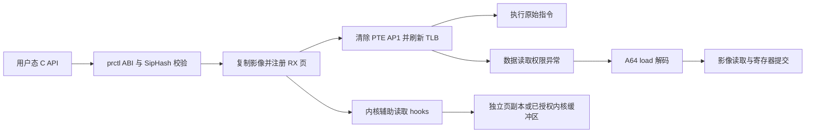

# UROV-Z 实现审查与验证记录

> 历史审查：以下结论适用于 1.0.0 发布前基线。当前 1.2.5 的修订与未覆盖范围见 [当前审计](compatibility-audit-1.2.5.zh-CN.md) 和 [技术博客](implementation-1.2.5.zh-CN.md)。

审查日期：2026-11-11（Asia/Shanghai）。独立仓库基线：`0daca2d`，审查时分支 `codex/urov-z`。以下保留发布前小米 13 审查的原始范围和数据；后续 Pixel 6 发布验证及当前交付文件见 [RELEASE-1.0.0.md](RELEASE-1.0.0.md)。本报告中的修复与新增 API 随 UROV-Z 1.0.0 提交到 `main`。外层 KernelPatch 仓库已有的修改未纳入独立仓库提交。

## 结论

框架可以用于受控的 Android ARM64、RX 文件代码页读取覆盖实验。认证控制协议、运行时 BTF 适配、失败回滚和显式能力标志具有清晰设计，但目前还不能认定为符合 Linux MM 并发规范的通用模块，也不能宣称全面兼容所有 Linux 5.x / 6.x。

本次实际连接的是 **小米 13 / fuxi、Android 13、Linux 5.15.74、4 KB 页、KernelPatch c00**。原始版本在该设备上能加载，却在 `process_vm_readv` 测试返回原值；修复后，使用新用户态 API 的测试 App 在 live / detached BTF 两条加载路径下各通过 **73 项**，模块核心自检 **4152 项**，卸载后基线 **5 项**通过。

6.1 的实机成功记录来自仓库原有的 Pixel 6 测试，本次没有连接或重新运行该设备。本次重新检查了保存的 6.1 / 6.12 / 6.18 / 6.18 16 KB BTF；这些结果不等价于新工作树在那些内核上的实机验证。

## 实现拆解

| 代码 | 实际职责 |
|---|---|
| `module/urov_z.c` | KPM 元信息与 init / ctl0 / exit；ctl0 提供全局状态 |
| `module/backend.c` | 唯一 PAGE_AP 后端、会话和页影像、异常处理、GUP/远程读取、映射及 fork 生命周期 |
| `module/decode.c`、`emulate.c` | A64 访存指令解码与独立寄存器模型；后端另外实现 FPSIMD 和辅助写入路径 |
| `module/readers.h` | 一个 64 位原子字中的开关、epoch 和两组读者计数，保护影像存储生命周期 |
| `module/compat.h`、`btf.h` | task/mm/VMA/FPSIMD 偏移、函数原型、FOLL 常量和页表几何校验 |
| `module/window.h`、`prewin.h` | LL/SC 窗口与指令流分析；不等于任意独占指令序列都可透明模拟 |
| `api/` | 独立用户态 C API，模块和客户端共享协议定义；支持 C++ 调用、静态/动态库 |
| `app/` | 普通 untrusted_app 回归程序、可控 `.text` fixture、结构兼容性测试 |

注册流程复制原始页快照与替代影像，检查普通 RX 文件 VMA 和页表 leaf，再清除 leaf PTE 的 `PTE_USER`（AP[1]），广播 TLB 失效。页表仍指向原始代码，受支持的 EL0 数据读取触发 data permission fault。`do_mem_abort` before-hook 校验 ESR/FAR/上下文并解码 load，按覆盖范围从替代影像或 native snapshot 获取数据，成功后提交 GPR/FPSIMD、writeback 和 PC。读取指令位于目标页时，操作码取自原始快照。

`/proc/pid/mem` 等调用完成 Linux 原始权限检查后，通过远程 VM helper 的返回缓冲区覆盖结果。`process_vm_readv` 在 syscall 全程保留 reader 引用，将成功 pin 的源页替换为独立影像页，并使用匹配的 grab/unpin helper。`vmsplice` 使用普通 GUP 页引用。全局仅一个会话，控制权绑定 owner mm；SET 在 spare 中准备影像，交换 image 指针并等待旧 epoch 读者退出。

## 本次发现并修复的问题

| 严重度 | 原问题与证据 | 修复及验证 |
|---|---|---|
| P1 | 5.15 厂商构建绕过公开 GUP wrapper。原始 App 第 27 项失败；诊断确认 readv 返回 32 字节 `11 11 11 11`，syscall hook 命中而公开 pin hook 未命中。修复 readv 后 vmsplice 也返回原始影像。 | `resolve_symbols` 优先选用经完整 BTF 签名校验的 `__get_user_pages_remote`、`internal_get_user_pages_fast` / `gup_fast_fallback`，缺失时回退公开入口。内部 remote 必须带 FOLL_PIN；fast 排除 PIN/LONGTERM/FAST_ONLY 并要求 GET。两条实机读取路径均通过。LTO 内联是与这些观测及上游 wrapper 结构一致的解释，未将它描述为已反汇编证明。 |
| P1 | fast-GUP 返回 `int`，旧代码将整个 X0 按 `long` 判断；AArch64 W0 中的负 errno 可能被当作很大的正数，继续访问无效 page 数组。 | 明确转换为 `int32_t` 后判断；增加 vmsplice 无效地址保留 EFAULT 与随后覆盖正常的测试。 |
| P1 | `mprotect(base, 1, ...)` 在 Linux 中覆盖整页，旧 after-hook 却要求整页落在原始长度内，遗漏 rearm。 | 以页基址是否落在成功 syscall 范围内判断；增加一字节 mprotect 与 RX 恢复回归。 |
| P1 | PROT_NONE 清除 armed 后，非驻留页首次重新 fault-in；PTE CAS 返回 1 表示已修改，旧逻辑只在返回 0 时发布 armed。 | 改为非负成功均发布 armed；测试 PROT_NONE → DONTNEED → RX → 首次读取与执行。 |
| P2 | fast-GUP 影像页分配失败时 `continue`，会静默返回原始页。 | 释放本次 native/substituted 引用、返回 ENOMEM 并计失败；正常路径回归通过。本次没有对设备注入 OOM，此异常分支仅做代码检查。 |
| P2 | 通用 BTF FOLL flag 查询遇到重复冲突定义会接受第一个值。 | 与 FOLL_FORCE 检查一致，冲突/非单 bit 返回不可用；补充合成 BTF 回归。 |
| P2 | 原测试只报告两个并发线程的总采样，无法证明两条读取路径都实际运行；脚本删除旧报告失败时可能读取旧结果。 | 等待两个线程均完成读取，分别报告 direct/readv 采样，统计实际成功更新次数；删除旧报告或 force-stop 失败时中止测试。 |

相关实现以函数名定位：`uz_remote_gup_argc`、`resolve_symbols`、`uz_pin_after`、`uz_gup_after`、`ap_protection_update`、`uz_mm_fault_after`。协议内容未改变，新增的 size/MAC offset 断言使 API 和模块编译时共同检查 ABI。

上游依据：[Linux 5.15 GUP](https://raw.githubusercontent.com/torvalds/linux/v5.15/mm/gup.c) 中公开 wrapper 转入内部实现；[process_vm_access](https://raw.githubusercontent.com/torvalds/linux/v5.15/mm/process_vm_access.c) 和 [iov_iter](https://raw.githubusercontent.com/torvalds/linux/v5.15/lib/iov_iter.c) 分别使用 pin 和普通 GUP。较新版本的参数及引用处理不同，参见 [Linux 6.6 GUP](https://raw.githubusercontent.com/torvalds/linux/v6.6/mm/gup.c)，因此不能只靠版本号或 symbol 存在性选择私有入口。

## 仍未解决的审查发现

这些是代码层面的限制，不是本次 73 项测试覆盖后可以忽略的问题。

1. **[P1] 原生 PTE/VMA 锁不足。** `page_update_bits_locked` 名称里的 locked 并不表示持有 Linux split PTE lock；实际是 walker + CAS，外围只有 RCU/关中断或部分 mmap lock。`uz_repair_trap`、`uz_page_by_identity` 等路径还直接获取/访问 VMA。mmap 锁不串行化所有 reclaim、迁移和 leaf 更新，RCU 也不证明修改的仍是当前挂接的页表。应按目标内核实现并验证 native PTL/VMA 锁适配，重新检查上级表及映射身份。参考 [Linux split page table lock](https://docs.kernel.org/mm/split_page_table_lock.html)。
2. **[P1] 并发 mremap 会原地重排读者正在引用的描述符。** `uz_mremap_update` 修改 base，再调用 `uz_page_sort` 逐字段移动含 image/snapshot 指针的结构。普通异常读者不获取控制锁，epoch 当前只保护释放，不保护这个排序事务。可能读到不一致的地址/影像组合。需要发布不可变描述符表并经过 grace period 回收，或建立真正可排他的读者协议。本次未执行并发映射压力测试。
3. **[P1] 子快照仍依赖父页的状态。** 子进程有独立 image/snapshot，但 `uz_page_for_fault` 返回父会话描述符，`uz_abort_before` 检查其 armed，`ap_shadow_rearm` 检查其 want/dead，父 munmap 还会标记 gone。父进程改变保护或移除映射后，仍持有原映射的子进程不能被保证继续获得注册快照。应将子映射生命周期和 arming 状态与父描述符分离。已测的是父 SET、子快照隔离和存活子阻止注销，不是任意父子映射变化。
4. **[P1] 写入、LL/SC 与原生单步不是完整的内存模型实现。** `page_store_bytes` 会原地修改 image/snapshot，有限次数 seqlock 重试后的 fallback 可读到并发写入；SET 与这些 writer 也不是统一事务。`uz_replay_begin` 临时恢复 AP，其他线程可能读到原值。原子操作还需要证明与未被 hook 的 CPU/内核写入保持同一线性化顺序。当前验证范围是保持 RX 的代码页读取。
5. **[P1，宿主依赖] 活动会话卸载不能由旧 loader 保证安全。** `sleepable-v2` 元数据不会升级设备上已经运行的 KernelPatch；旧 loader 可能处于 RCU 上下文且忽略 exit 错误。必须先由 owner 注销，确认全局 `inactive pages=0 armed=0` 后卸载。现有底层 hook 的卸载并发保障同样依赖宿主版本。

维护方面，backend 仍超过 6300 行，残留旧版本注释和 `kclf_*` BTF 命名；控制、页表、远程读取、生命周期及 replay 值得按职责拆分。这属于可维护性问题，不应以格式调整代替上述并发修复。

## 兼容性矩阵

| 内核 / 配置 | 本次证据 | 可作出的结论 |
|---|---|---|
| fuxi 5.15.74 / Android 13 / 4 KB | live 与 detached 实机各 73/73 | 本报告列出的受控 RX 场景通过 |
| oriole 6.1.134 / 4 KB | 本次保存 BTF 复查；原仓库 49/49 实机记录 | 旧基线有运行证据，新工作树尚未在该设备重跑 |
| GKI 6.12 / 6.18 / 4 KB | MM/VMA/FPSIMD、GUP ABI 和 flag 的 BTF 检查 | 结构适配检查通过，无本次运行验证 |
| GKI 6.18 / 16 KB | 同上，保存的 16 KB BTF | 结构检查通过，尚无 16 KB 运行验证 |
| 5.4 | 合成函数签名测试、已有回退实现 | 尚无对应实机或真实 5.4 BTF 证据 |
| 5.0–5.3、7.x、AArch32、64 KB、LPA2 | 加载条件明确拒绝或不在实现范围 | 不支持 |

`resolve_kernel` 的版本准入是 **5.4 ≤ version < 7.0**，这不是全范围认证。厂商 backport、LTO、缺少符号或 BTF、不同页表几何仍可能拒载或缺少能力。5.15 本机 `caps=0xbc3f`，FPSIMD、远程读取、readv、GUP 和 fork 快照可用；STEP 不可用，因为该内核 debug exception 的 32 位 ESR 签名不满足当前保守适配要求，本次没有启用或认证 native step。

## 最终验证结果

NDK 26.1.10909125，SDK Build Tools 36.0.0 / android-36。KPM 使用 `-Wall -Wextra -Werror -Wformat=2 -Wshadow`；API 使用严格 C11，C++17 头文件/链接 smoke 使用 `-pedantic -Werror`。PowerShell 和 NDK CMake/Ninja 两种 API 构建均通过；静态和动态库查询示例均在设备上运行。

App UID 为 10322，域为 `u:r:untrusted_app:s0:c66,c257,c512,c768`，未提升测试 App 权限。

| 最终运行 | 检查数 | 成功 SET_PAGE | direct 读取 | readv 读取 | 撕裂/错误样本 |
|---|---:|---:|---:|---:|---:|
| live BTF | 73 / 73 | 48 | 2,601 | 547,441 | 0 |
| detached BTF | 73 / 73 | 48 | 2,621 | 563,208 | 0 |
| 卸载后基线 | 5 / 5 | — | — | — | 0 |

覆盖包括原指令执行、目标页内部读取者、标量/pair/跨页、LDR Q/LD2/LD4、libc/CRC、proc mem/readv/vmsplice、无效 GUP 地址、描述符拒绝、generation 冲突、并发更新、mprotect/refault、fork 隔离、对子快照的注销保护，以及 API 错误/输出约定和 8/32 字节 inline 请求。

最终两次 STATUS 均为 `inactive pages=0 armed=0 degraded=0`。模块已卸载，KPM list 为空。前后 boot ID 都为 `19efbd2e-d7f8-4986-b3d5-07e634389840`。本次采集的测试窗口 dmesg 未出现 WARN/Oops/panic/BUG 标记；这不是对日志采集范围外事件的保证。错误 Build ID 的 detached BTF 被拒绝，错误模块密钥返回 EINVAL，卸载后 API 查询也正常返回 EINVAL。

主要本地证据（均位于忽略的 `out/`，不会提交密钥）：

- [最终 live App](../out/audit-20261111-fuxi/app-final-live.txt)、[最终 detached App](../out/audit-20261111-fuxi/app-final-detached.txt)、[卸载后基线](../out/audit-20261111-fuxi/baseline-after.txt)。
- [5.15 / 6.1 BTF](../out/audit-20261111-fuxi/compat-5.15-6.1-final.txt)、[6.12 / 6.18 BTF](../out/audit-20261111-fuxi/compat-6.x-final.txt)。
- [原始 readv 失败](../out/audit-20261111-fuxi/app-readv-diagnostic.txt)、[修复 readv 后暴露的 vmsplice 失败](../out/audit-20261111-fuxi/app-readv-fix.txt)。
- [测试窗口内核日志](../out/audit-20261111-fuxi/dmesg-test-window.log)、[最终文件 SHA-256](../out/audit-20261111-fuxi/sha256.txt)。

最终 KPM SHA-256：`5A35A8B74F49B55D1E6168C087AEE173DD6A519D1557F2EA4C4A62C5F53AE9B7`。

## 用户态接口交付

见 [api/README.md](../api/README.md) 和 [公开头文件](../api/include/urov/urov.h)。六个协议操作全部有 typed API；保留 `urov_call` 供底层协议测试。上下文只保存派生密钥，成功/失败约定统一，不自动吞掉 EBUSY/EAGAIN，不自动注销或加载模块。

API 是 syscall 封装，不扩展模块本身的并发或内核兼容保证。后续在 5.4/5.10、6.1/6.6 及 16 KB 设备上的运行验证，以及原生 PTL/映射并发修复，仍是把此实验框架提升为通用方案所需的工作。
