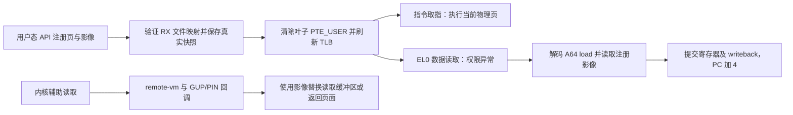

# UROV-Z 1.1.0 内核实现分析

核对日期：2026-11-12。本文保留当时单页测试说明；2026-11-13 的十页应用内复测、固定密钥和耗时口径见 [当前集成说明](../INTEGRATION.md)。范围是本独立仓库的 1.1.0 源码；运行证据分为
[此前集成实测](../integration/RESULTS-2026-11-12.md)与[本次发布验证](../RELEASE-1.1.0.md)。

## 一次读取如何得到替代值

框架维护同一代码页的两种观察结果：CPU 仍从当前物理代码页取指；支持的数据
读取路径返回注册影像。UROV 本身不修改目标函数指令。1.1.0 的 Dobby 测试负责
修改真实指令，UROV 负责让数据读取取得 hook 前保存的页内容。

上图的最后一条路径共享影像数据，但不执行用户态寄存器提交：内核读取回调
处理返回缓冲区或页面。异常模拟与内核辅助读取是两条独立的实现路径。

## 入口、认证与会话

- [module/urov_z.c](../module/urov_z.c) 声明唯一一组 KPM 元数据及 init/ctl0/exit。
  初始化先启动 UROV，再启动 KCLF，并分别记录成功标志。`status/selftest` 查询
  UROV；`kclf,` 前缀转入加载器控制。`selftest` 显示初始化自检结果，不重新执行测试。
- [api/src/urov.c](../api/src/urov.c) 封装私有 `prctl` 协议。16 字节模块密钥派生
  option 与 MAC 密钥，客户端为结构化请求计算 SipHash MAC。后端
  `uz_prctl_before` 检查 option、magic、结构大小、ABI 版本、操作码、用户地址和
  MAC，之后才调用 `dispatch`。设备 kpatch superkey 与模块 API 密钥互相独立。
- 当前全局最多一个活动 owner `mm`。后续 SET/DEACTIVATE 受地址空间 ownership
  约束；SET 使用 `expected_generation` 拒绝过期更新。API 的 `session=1` 是
  当前协议的状态标记，不是可自由转移到其他进程的内核会话句柄。

## 注册和页表操作

[module/backend.c](../module/backend.c) 的 `validate_target_vma` 要求目标页完整
位于可读、可执行、当前不可写的文件映射中，排除 IO、PFNMAP、hugetlb、mixedmap
和匿名页；共享映射另有限制。注册检查描述符、排序并拒绝重复页，保存映射身份、
真实快照及替代影像。

默认主影像预算为 8 MiB，每个注册页的 arena 占七页，用于 image/spare、真实
快照、写入协作与外部写入缓冲。4 KiB 页下预算对应 292 页；这不是包含所有
辅助结构、代码扫描和子进程快照的总内存上限。

`ap_arm_pages` 在映射锁内重新核对 VMA，对页表叶子用 CAS 清除 `PTE_USER`
（AP[1]），保持执行相关位，并广播 TLB 刷新。它要求叶子原来可供用户读取、只读，
且未设置 UXN/DBM。页表遍历和 CAS 还使用 RCU 或适用配置下的 IRQ 保护。
初始化会检查平台能力；这个权限方案不能脱离具体 ARM64 配置当作通用保证。

注册开始安装 trap 前先发布可供异常路径使用的会话和真实视图；所有页安装成功
后才启用替代值。中途失败走恢复与释放路径，避免异常处理访问尚未准备好的页数组。

## 异常解码和寄存器提交

`uz_abort_before` 拦截 `do_mem_abort`，检查 EL0/A64、数据异常类别、叶子权限错误、
FAR 和会话归属。`uz_read_insn` 取得实际执行指令；`uz_emulate_load` 调用
[decode.c](../module/decode.c) 计算访问地址、宽度、目标寄存器与 writeback。

影像读取按覆盖范围拼接，普通范围使用真实数据，覆盖窗口使用注册内容。
GPR 路径处理符号扩展、W 寄存器截断、SP/writeback 和 PC；SIMD/FP 路径通过
已验证的 FPSIMD 布局与辅助函数提交向量状态。`emulate.c` 的通用纯 GPR 模型
与内核后端的向量提交不能混为一谈。

不支持的编码、坏地址和缺失 FPSIMD 能力会拒绝模拟，记录失败并按相应路径
发出信号；不能把所有 load、原子序列或任意程序都视为已覆盖。1.1.0 默认
`UROV_Z_NATIVE_STEP=0`，不安装可选的 debug exception / scheduler 单步 hook。

## 内核辅助读取、更新与退出

`uz_kread_after`、GUP/PIN 和 process-vm 相关回调补齐内核辅助读取。模块自身
构建真实快照时，通过 `uz_access_vm` 的 current-task 内部槽避免回调把快照
改为替代影像；该例外只存在于同步调用期间，不是用户态调用者白名单。

[readers.h](../module/readers.h) 将关闭标记、epoch 和两组读者计数放入同一
原子字。SET 先准备 spare，再交换影像、翻转 epoch 并等待旧读者排空，最后
复用旧缓冲区。generation 表示更新次序；不会承诺任意多次独立读取构成事务。

映射 syscall、缺页及 `copy_mm` 回调跟踪重映射和 fork。子进程具有继承快照
语义；仍存活的子快照会令 DEACTIVATE 返回 EBUSY。`release_session` 先停止
rearm、排空相关读者、恢复 AP 位并刷新 TLB，再关闭读者入口和释放资源。
owner 死亡后的回收在后续认证控制调用的可睡眠路径执行。

## KCLF 和 Dobby 如何协作

[module/kclf](../module/kclf/README.md) 内置 KCLF 1.5.7 的六个编译单元。
`UROV_KCLF_EMBEDDED` 禁用独立 KPM 入口。加载器持有目标 PID 引用并核对
task/mm 身份，最多四个请求槽；借目标 `task_work` 准备映射，重定向返回 EL0
的上下文。manual 后端负责 ELF 映射、依赖解析、重定位与初始化；linker 后端
调用目标 bionic loader。完成 token、syscall 观察及后续 task_work 协同完成清理。

集成改变的关键接口是 `kclf_urds -> urov_z_read_current_real -> uz_access_vm`：
加载器内部能读取真实 ELF 字节；注入后的 SO 仍遵守 all-callers 影像规则。
另一个修正是 `ke_relro_contains` 允许 writable PT_LOAD 最后一页的合法 RELRO
padding，其他 ELF 范围检查仍严格使用 `ke_contains`。

[integration/payload.c](../integration/payload.c) 的构造函数只发布测试入口。
控制脚本确认加载完成后，按以下顺序验证：

1. 保存原代码页，DobbyHook 修改真实代码；目标 `(3,4)` 从返回 25 变为 1103，
   原函数实际接收 `(13,12)`，代码段 CRC 应变化。
2. REGISTER 保存的原页影像；函数仍返回 1103，直接读取、process_vm_readv、
   proc-mem 三个 CRC 应恢复基线。
3. 活动覆盖期间再次注入 probe，检查新 SO 同样读到基线而执行 hook 后函数。
4. DEACTIVATE 后 CRC 再次变化；DobbyDestroy 后返回值和 CRC 恢复。

payload 强制 near trampoline 并校验入口为 `B imm26`，因为覆盖页里的
`LDR literal` 远跳转会读到替代字节，无法获得写入后的跳转地址。UROV 不会
自动使任意 Dobby trampoline 或被重定位的原指令与读取覆盖兼容。

## 结论和验证范围

这是具备认证控制、并发影像更新和生命周期处理的代码页读取覆盖实验框架。
1.1.0 增加了统一 SO 加载入口和独立的 hook/CRC 联合验证，但仍受支持指令、
文件 VMA、内核布局与目标线程协作边界约束。manual 匿名镜像自身不符合当前
REGISTER 条件；加载器也不等同于完整 JNI/C++ 运行环境。

本次发布重新构建全部交付目标，执行 4152 项核心模型检查与 14 项 RELRO
断言；KPM 和三个集成 SO 与此前实测哈希一致，两套 APK 的全部非签名文件
内容也与设备上此前实测安装包一致。此前的 73 项 App 回归和 manual/linker
各三轮结果保留为历史证据，本次没有重新运行完整注入或覆盖生命周期。

热卸载仍未获得安全证明，`inactive` 或 `quiesce=idle` 不代表宿主跳板已经
无人执行。发布保持实验性预发布标记；内核替换按既有受控重启流程进行。
