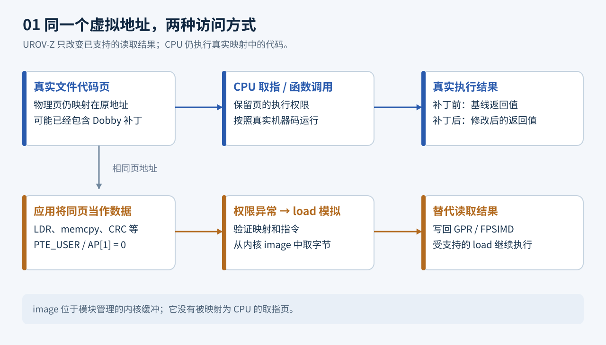
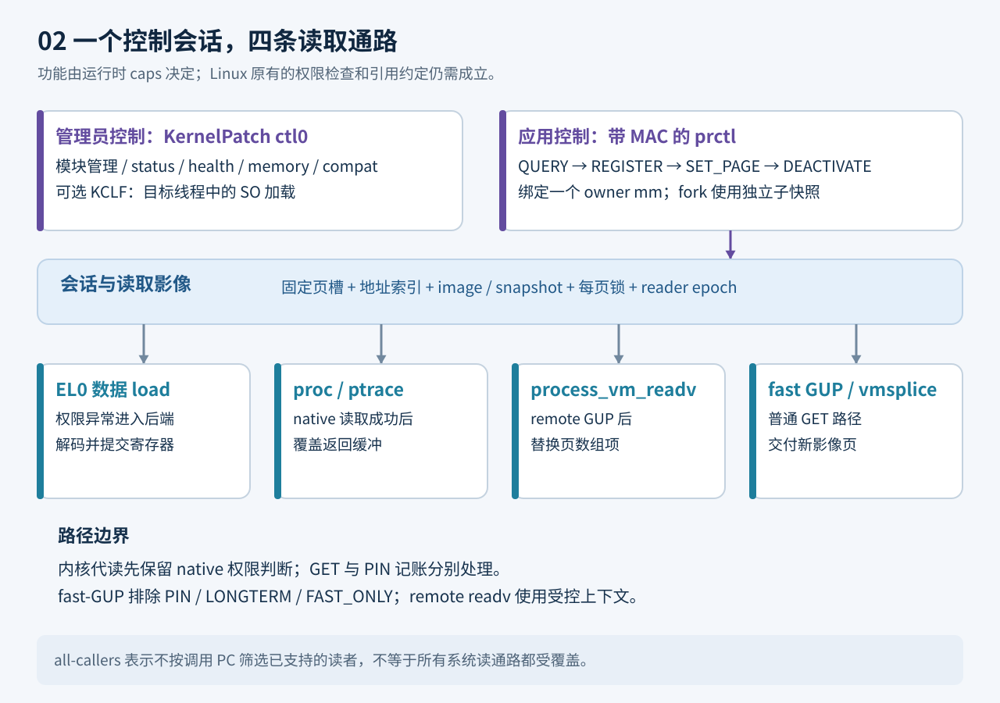
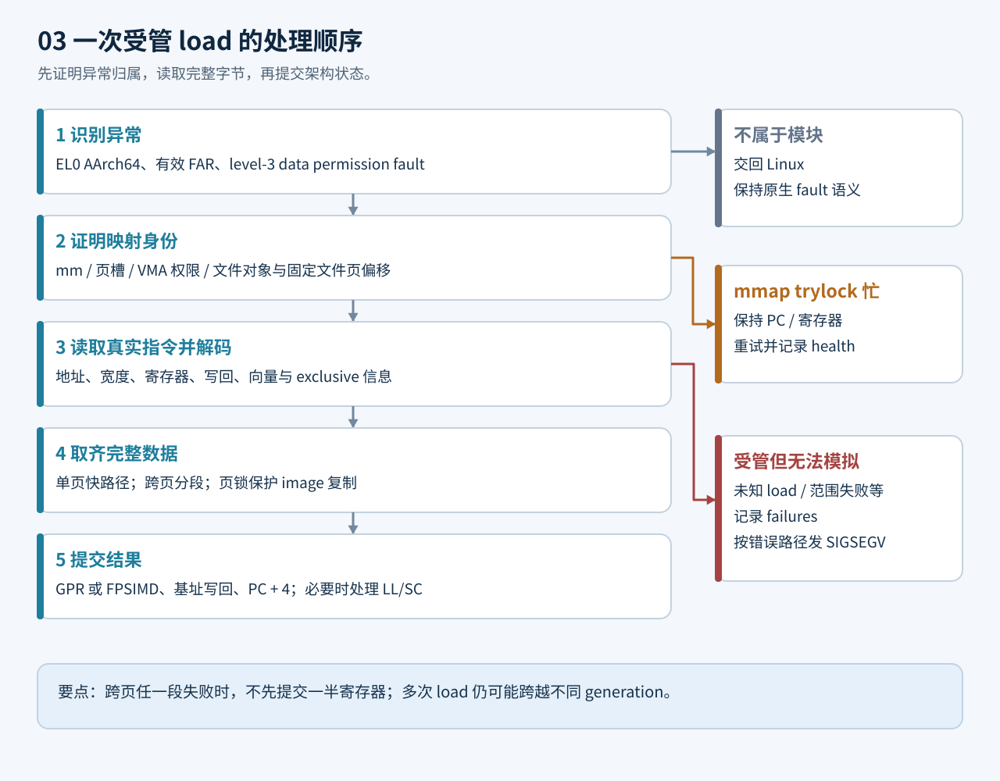
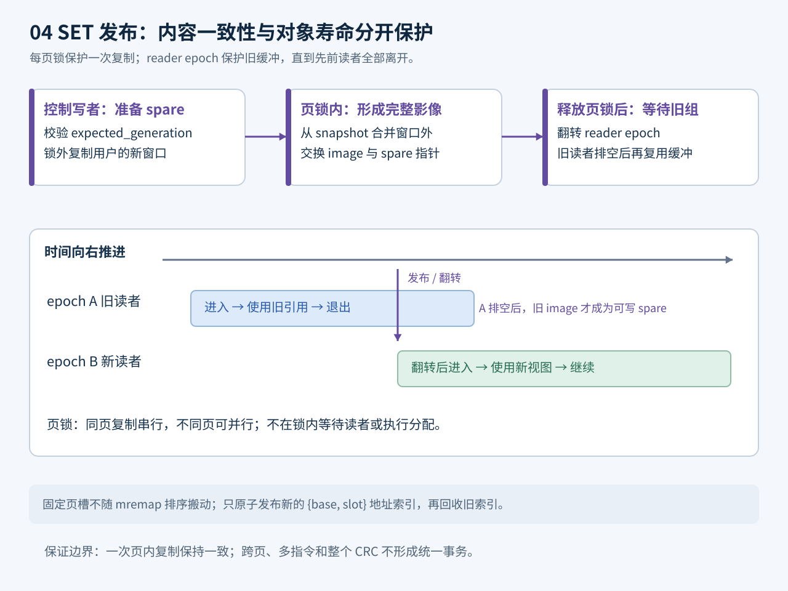

# UROV-Z 1.2.5 实现解读：代码照常执行，读取结果怎样变成另一份字节

本文对应 `urov-lab` **1.2.5**，用户态协议仍为 **ABI v1**，内置可选加载器为 **KCLF 1.5.7**。整理日期为 2026-11-14。实现判断以当前源码为准；文中的实测数字明确引用已有的 [1.2.5 兼容性审计](compatibility-audit-1.2.5.zh-CN.md)，不把历史记录当成本次重新执行的测试。本轮构建与复验结果、发布产物对应关系见 [1.2.5 发布说明](RELEASE-1.2.5.md)。

适合的阅读顺序：先看第 1～4 节建立概念，再顺着一次注册和一次读取进入第 5～9 节，最后看生命周期、兼容性、测试与限制。只想运行实验，可以先看仓库 [README](../README.md)。

## 1. 从一个能观察到的现象开始

假设一个函数位于应用的代码页中。程序可以用两种方式访问这块内存：

- **执行它**：CPU 把其中的字节当作指令，调用函数并得到返回值。
- **读取它**：程序把相同地址当作数据，使用 `LDR`、`memcpy`、CRC 扫描，或者让内核代为读取。

UROV-Z 给第二种访问提供可配置的替代字节，第一种仍执行当前真实代码页。它不是把所有函数的返回寄存器改成一个常量；其直接作用对象是**从已注册代码页读出的内存值**。函数行为的修改，在集成实验里由 Dobby 完成。

用一本书来类比：演员照着书上的台词演出，检查员查询文本时得到另一份校样。代码页是演员的剧本，内核保存的 `image` 是查询时使用的校样。这个类比只解释两条访问路径；它不意味着所有观察方式都被覆盖。



一个重要细节是：图中的“真实代码”指**注册当时实际映射的内容**，可能已被 Dobby 修改。UROV 的注册本身不把原物理页替换成影像，也不负责把 Dobby 补丁还原。

集成 APK 正是利用这个区别，做出可重复的五阶段实验：

| 阶段 | 真正执行的内容 | 读取代码得到的内容 | 预期现象 |
| --- | --- | --- | --- |
| `loaded_inactive` | 原函数 | 原始代码 | 返回值与 CRC 都是基线 |
| `hooked_uncovered` | Dobby 修改后的路径 | 修改后的代码 | 返回值改变，CRC 也改变 |
| `overlay` | Dobby 修改后的路径 | 调用者提前保存的原始影像 | 返回值保持修改后的结果，CRC 恢复基线 |
| `deactivated` | Dobby 修改后的路径 | 修改后的代码 | 返回值仍改变，CRC 再次显示补丁 |
| `unhooked` | 原函数 | 原始代码 | 两者都回到基线 |

因此“CRC 恢复”只是一个已定义读取通路的实验结果，不能等同于不存在补丁、没有额外开销，或无法通过其他方式观察差异。

## 2. 仓库里的各部分分别负责什么

| 目录或文件 | 职责 | 建议关注的入口 |
| --- | --- | --- |
| [module/urov_z.c](../module/urov_z.c) | KPM 元数据、加载/退出、管理员命令分派 | `module_init`、`module_control`、`module_exit` |
| [module/backend.c](../module/backend.c) | 会话、异常处理、内核代读、映射生命周期及 hook 编排 | `do_register`、`uz_abort_before`、`dispatch` |
| [module/decode.c](../module/decode.c)、[emulate.c](../module/emulate.c) | 指令解码与无操作系统依赖的基础模型 | `uro_decode`、`uro_emulate` |
| [module/compat.h](../module/compat.h)、[btf.h](../module/btf.h) | BTF、类型布局、原型和地址几何检查 | `uz_layout_from_btf`、`uz_geometry_from_tcr` |
| [module/pt_access.h](../module/pt_access.h)、[pt_leaf.h](../module/pt_leaf.h) | 页表访问保护、原生 PTL、leaf 修改 | `uz_pte_access_locked`、`uz_pte_apply` |
| [module/mapping_identity.h](../module/mapping_identity.h) | 判断当前映射是否仍是注册时的文件页 | `uz_mapping_matches` |
| [module/readers.h](../module/readers.h)、[page_index.h](../module/page_index.h) | 读者寿命、双 epoch、不可变地址索引 | `uz_reader_enter`、`uz_index_publish` |
| [module/short_lock.h](../module/short_lock.h)、[buffer_budget.h](../module/buffer_budget.h) | 每页短锁、分配预算 | `uz_short_lock_take`、`uz_buffer_reserve` |
| [api/include/urov/urov.h](../api/include/urov/urov.h)、[api/src/urov.c](../api/src/urov.c) | 普通应用可调用的 C API | `urov_register_pages`、`urov_set_page` |
| [module/kclf](../module/kclf) | 可选 SO 加载器、ELF 处理和目标线程工作 | `kclf_preflight`、`kclf_exec_hijack` |
| [app](../app) | UROV-Z Lab 基础功能 APK、控制和兼容检查工具 | `app.c`、`compat_check.c` |
| [integration](../integration)、[Dobby](../Dobby) | 十页 CRC 与函数行为的端到端实验 | `host.c`、`payload.c`、`target.S` |
| [tests](../tests) | 纯模型、并发、资源和设备生命周期回归 | `host_compat.sh`、`lifecycle_device.c` |

这里有两个容易混淆的“模拟器”。`emulate.c` 是便于独立验证的基础 GPR 模型；真正运行中的完整后端是 `backend.c` 中的 `uz_emulate_load`，它还处理运行时页大小、多页影像、FPSIMD、子快照以及 LL/SC。因此，只看 `uro_emulate` 不能推导整个模块的运行能力。

## 3. 总体结构：控制面和读取面分开

**控制面**回答“谁注册了哪些页、影像是什么、何时更新或退出”。**读取面**回答“当前这一次 CPU load 或内核读取应该得到哪些字节”。



控制面又有两个入口：

1. 管理员通过 KernelPatch 的 `kpm ctl0 urov-z ...` 查看模块、修改 inactive 状态下的配置，或者调用 `kclf` 子命令。这条入口使用设备管理权限。
2. 普通应用通过带认证的 `prctl` 请求操作**自己的地址空间**，不需要为每次调用取得 root。这条入口使用 16 字节模块密钥。

设备管理密钥与模块密钥不同。仓库的固定测试模块密钥仅服务于可重复实验，不构成生产环境的秘密管理方案。

全局只有一个 `g_sess`。同一进程的线程共享 `mm`，可以共同读取和控制这个会话；另一独立地址空间不能仅凭 `session=1` 接管它。fork 子进程有专门的快照机制，但不是另一个可任意控制的注册会话。

`callers=all` 表示替代读取不按某个调用 PC 白名单放行：在受支持路径和目标映射范围内统一使用影像。它既不表示全系统每个地址都被覆盖，也不绕过 Linux 原本对远程读取的权限检查。

## 4. PAGE_AP：保留执行，截获数据访问

ARM64 页表的 leaf PTE 同时描述物理页、权限等属性。UROV-Z 对符合准入条件的 RX 文件页清除 `PTE_USER`，即这里使用的 AP[1] 位；执行权限和物理页地址保留。于是受管 EL0 数据访问触发权限异常，CPU 取指仍沿真实映射运行。

这不是简单地调用 `mprotect(PROT_NONE)`：后者会改变应用可见的正常访问契约。这里由模块自己管理一个特定的 leaf 权限形态，再在异常处理时识别它。

`uz_abort_before` 只接管满足条件的异常，例如：

- AArch64 EL0 上下文，排除 AArch32 compatibility mode。
- data abort 的 EC 为 `0x24`，FSC 为 level-3 permission fault `0x0f`。
- FAR 有效；排除页表遍历相关、外部异常等不匹配情形。
- 地址位于受管页，当前 VMA 身份匹配，权限与页状态允许提供该影像。

这组筛选很关键：一个普通的空指针、越界读或真正的 `PROT_NONE` fault，不能因为模块存在就被解释成“返回替代数据”。不属于模块的异常继续交给 Linux。

### 为什么还需要 Linux 原生页表锁

“只改一个位”仍然是页表并发操作。单独做 CAS 只能保护这一个机器字的交换，不能证明页表页未被拆卸，也不能替代内核自己的 PTL。Linux 的 split page table lock 设计由每张表的锁保护相应访问，官方说明明确区分映射、加锁与解锁辅助函数。[Linux 页表锁说明](https://docs.kernel.org/mm/split_page_table_lock.html)

1.2.5 的顺序是：

1. 取得 mmap 保护；异常/GUP 上下文使用 trylock，避免递归阻塞在排队写者后面。
2. 只沿上级 table descriptor 走到 PMD，拒绝把 huge/block 项当普通下级表。
3. 优先使用 `apply_to_existing_page_range` 的完整 native callback，让内核配平 PTL、RCU、lockdep 等状态。
4. 完整 callback 不可用时，才考虑严格校验的 `__pte_offset_map_lock` 路径；其 raw unlock/RCU 配对受配置限制。
5. 更旧内核仅在 `<5.8` 且无新表回收路径证据时，允许“先确认已有 PMD，再调用 `apply_to_page_range`”。
6. 在 native PTL 内检查 leaf，CAS 保留可能并发更新的 AF/DBM 位，完成 TLBI，再释放保护。

因此，旧文档中“优先 map-lock”不是 1.2.5 的选择顺序。当前优先完整 callback，因为它把更多内核配置细节留给内核自身处理。

### 连续 PTE 不能逐项硬拆

当 PTE 带 `PTE_CONT` 时，一组项共同描述连续映射。当前实现只在验证了 `__contpte_try_unfold` ABI 和运行符号后，交给 native helper 完成拆分，再在同一 PTL 内重读目标项。没有 helper 就拒绝所需修改；只读检查不会主动拆组。Linux 的 native 转换会处理整组、AF/dirty 汇总及 TLB 失效。[Linux 6.12 ARM64 contpte 实现](https://raw.githubusercontent.com/torvalds/linux/v6.12/arch/arm64/mm/contpte.c)

## 5. 一次 REGISTER：先准备完整影像，再开放替代读取

`do_register` 是理解框架最好的入口。它没有把用户指针长期保存下来，等发生 fault 时再访问，而是在注册期间把需要的字节复制到模块管理的缓冲。

### 5.1 哪些映射可以注册

`validate_target_vma` 要求目标页：

- 按**运行时页大小**对齐，且整个页位于有效用户地址和一个 VMA 内。
- 同时具有 `VM_READ`、`VM_EXEC`，没有 `VM_WRITE`。
- 有文件背书；排除 PFNMAP、HUGETLB、IO、MIXEDMAP。
- 对共享映射还有更严格限制：VMA 必须恰好一页，且不能有 `VM_MAYWRITE`。

因此，普通任意堆缓冲或匿名 RWX 内存不是这个 API 的注册对象。4 KiB 是 ABI 中的历史默认常量，不能在调用端替代 `QUERY.page_shift` 或 `sysconf(_SC_PAGESIZE)`。

页描述符还要满足：页地址不重复、`reserved=0`、合法源标志，影像窗口至少 8 字节且长度为 8 的倍数，窗口不越过一页。多页/SET_PAGE 接口的 `length=0` 表示运行时整页；此时偏移只能为 0。

### 5.2 三份缓冲到底是什么

| 缓冲 | 默认 RX 下的含义 | 谁更新它 |
| --- | --- | --- |
| `snapshot` | 注册时从真实页复制的内容；用于窗口外基底和暂停期间的视图 | 注册创建；实验写入路径可同步修改 |
| `image` | 当前对读取提供的整页，初始为 snapshot 再覆盖调用者指定窗口 | REGISTER/SET，以及实验写入发布 |
| `spare` | 下次 SET 的候选缓冲 | 控制写者准备，再与 image 交换 |

这里的 snapshot 不是“磁盘最初的干净文件”。例如 Dobby 先补丁、UROV 后注册，snapshot 是**已经补丁后的真实页**；调用者传入的 image 可以是 Dobby 前保存的旧内容。暂停/退出期间使用 snapshot，就会与当前真实执行字节相符，而不是意外继续展示旧影像。

### 5.3 注册事务的实际次序

`do_register` 首先检查全局会话空闲，取得当前 `mm` 引用，复制和校验页描述符。描述符按地址排序，但保留调用者最初的页索引，保证之后 `SET_PAGE(index)` 的含义不变。

随后分配固定槽位、两个地址索引、主 arena 和可选子快照池；为每页捕获文件身份并建立 snapshot/image。可选 LL/SC 负面证明缓存分配失败不会直接取消注册。

真正修改第一张 PTE 前，代码先发布一个可读的会话，但令 `g_suspend=1`。此时 racing reader 可以得到 snapshot，不会碰到半初始化存储。待所有页成功 arm 后，才清除 suspend，让替代影像生效。arm 中途失败则调用公共释放流程恢复已改变的权限，并回收存储。

这是一种“准备好可回退的读取视图，再安装权限陷阱”的设计；它不是任意多页原子事务。测试者仍应避免在注册过程中同时修改目标映射。

## 6. 一次 LDR：异常里如何产生准确的寄存器结果

例如执行 `ldr x0, [x1]`，其中 x1 指向已注册页。`uz_abort_before` 证明它属于模块后，取出 fault PC 上的机器码，进入 `uz_emulate_load`。



### 6.1 解码只描述效果，不访问目标内存

`uro_decode` 输出 `uro_load`：有效地址、每个元素宽度、寄存器数量、总字节数、目的寄存器、符号扩展、基址写回、向量/独占标记等。它先在局部变量构造结果，失败不改输出对象。

后端还要检查完整地址范围、FAR 是否落在指令访问区间、上下文状态以及写回地址。解码成功并不自动证明映射有效。

| 指令类别 | 当前实现方式 | 需要区分的细节 |
| --- | --- | --- |
| GPR 单读 | unsigned immediate、unscaled、pre/post-index、register-offset、literal 等 | 符号扩展后再按 W/X 目的宽度处理 |
| GPR pair | LDP/LDPSW 等受支持形式 | 两个目的先计算完，再提交；拒绝不允许的寄存器重叠 |
| SIMD/FP 单读与 pair | 将字节写回经验证的任务 FPSIMD 状态 | B/H/S/D/Q 的宽度与剩余位清零规则不同 |
| LD1/LD2/LD3/LD4 multiple structures | 根据元素/结构交错关系分配到 V 寄存器 | 单次最多读取 64 字节；single-lane 组不是同一覆盖范围 |
| LDXR/LDAXR、LDXP/LDAXP | 解码附带 exclusive/acquire 信息 | 还需要 LL/SC 辅助处理，不能只写目的寄存器 |
| unprivileged alias | 后端对匹配编码转成已支持的普通 load 形式再解码 | 基础 `uro_decode` 本身仍拒绝对应 LDTR 类 |

SVE/SME、未知编码、越界等情形不在“解码若干条后自然全部兼容”的范围内。

### 6.2 先读齐字节，再提交状态

单页且状态符合的访问走快速分支：找到固定描述符、取该页锁、把所需字节复制到内核栈上的临时缓冲。跨页访问由 `read_range` 分段：受管段取影像，普通相邻段使用 nofault 用户读取；任何一段失败，都不能先提交一半目的寄存器。

GPR 路径按小端组装值、符号扩展、处理 32 位写入的零扩展及基址写回，最后把 PC 增加 4。向量路径先成功更新 FPSIMD，再提交 GPR/PC。对仍属于模块却无法正确模拟的读，记录 failure 并产生 `SIGSEGV`；不会默默放开权限让它读到另一份内容。

mmap trylock 暂时不可得是另一种情况：返回时保持 PC 和寄存器不变，让原指令重试，并累加 `fault_retries`。因此 `fault_retries>0` 不能直接解读成数据读取失败。

### 6.3 为什么指令抓取不能读 image

处理 fault 时必须解释 CPU **真正执行的机器码**，而不是用户为数据读取指定的替代影像。`uz_fetch_insns` 和模块内部 accessor 为此区分内部读取；内核代读 hook 识别 `uz_internal_current()`，避免把自身建立 snapshot、取指或控制回复的访问再次覆盖。

## 7. memcpy 之外：内核代读为什么还要三条补充路径

仅拦截 EL0 data abort 不够。应用调用系统调用后，真正的数据搬运可能在内核中完成，也可能直接获得 `struct page *`，完全不经过刚才的 EL0 指令模拟。

### 7.1 proc/ptrace：改写成功读取的返回缓冲

`uz_kread_after` 位于 `__access_remote_vm` 或可用的 public fallback 之后。Linux 先完成正常访问检查和读取；模块只对返回的有效字节范围做覆盖。

该函数的返回值是 `int`，在 AArch64 中应按 W0 的有符号 32 位解释。`uz_access_vm_result` 还要求成功长度不超过原请求长度。不能直接把整个 X0 当正的 64 位长度，否则一个负 errno 或未定义高位就可能变成巨大拷贝。

`uz_kread_overlay` 按页拆分已返回缓冲，属于 owner/子快照的部分替换为 image，其余保留原生结果。对应的 `FOLL_WRITE` 路径则按 RX 退役或 experimental 写入逻辑处理，不把写请求误当读请求。

### 7.2 process_vm_readv：替换 remote GUP 返回的页

`process_vm_readv` 常通过 remote GUP 获得页数组，然后由内核复制。模块在 syscall before 中保留 reader 引用，记录当前 task 的读取上下文；在 remote GUP after 中为受管页分配新的 order-0 页，复制影像并替换数组项；整个 native copy 完成后的 syscall after 才释放引用。

这里的核心难点不是 `memcpy`，而是**引用记账**。Linux 的 GET 与 PIN 使用不同的约定，不能互相替代。[Linux pin_user_pages 说明](https://docs.kernel.org/core-api/pin_user_pages.html)

- 旧 GET 路径：新分配页已有一个普通引用，移交给调用者；原页 `put_page`。
- PIN 路径：调用经 ABI 验证的 native grab helper 给新页建立 PIN 记账，放掉分配器普通引用，原页用 `unpin_user_page` 释放。
- 存在 PIN 能力证据但 PIN ABI 不匹配时，不冒充旧 GET 路径降级处理。

并发 readv 上下文槽有 64 个。槽耗尽返回 `EBUSY` 并增加 `readv_slots_full`。替代页分配或填充失败时，清理本批取得的页并返回 `ENOMEM`，不悄悄把原生字节作为成功结果交出去。

### 7.3 fast GUP：为 vmsplice 等普通引用读取提供页副本

`uz_gup_after` 覆盖可验证的 fast-GUP 入口，为普通 GET 读取替换新页。它主动排除 PIN、LONGTERM、FAST_ONLY，以及不满足内部入口 GET 标志的请求；真实写目标也不能用影像副本代替。

这解释了看似矛盾的两个事实：remote readv 路径可以在明确的 syscall 上下文里处理 PIN，而 fast-GUP 通用路径会排除 PIN。它们的使用范围和生命周期证据不同。

所有这些能力都由实际符号、原型、helper 和 hook 结果决定，最终通过 `caps` 暴露。缺少某条可选路径时，模块可能仍支持直接读取；调用者必须查能力，不能只看加载成功。

## 8. SET 与并发：每页锁、双影像和 reader epoch 各管什么

如果读线程恰好在控制线程更新时取 16 字节，不能前 8 字节来自旧影像、后 8 字节来自新影像。1.2.5 使用三个相互配合、但职责不同的机制。



### 8.1 每页短锁保护一次复制的内容一致性

每个 owner/child 页描述符都有 `image_lock`。`page_view`、写入发布、SET 交换和 GUP 页复制锁定实际源页。不同页无需争用同一把全局影像锁，同一页仍然串行。

持锁期间只做有界内核缓冲操作，不执行用户访问、内存分配、mmap 等待或 epoch 等待；内核侧同时排除本地 IRQ。锁忙时用 relaxed load/yield 等待，减少不断写同一 cache line 的竞争。

### 8.2 SET 先准备 spare，再交换指针

控制写者先验证 `expected_generation`，把新窗口复制到 spare。`page_swap_image` 在页锁内把 snapshot 的窗口外内容合并到 spare，再交换 image 指针并发布新窗口信息。

这也说明 SET_PAGE 的含义：它重建“snapshot + 当前新窗口”的整页，而不是自动累计此前所有不同窗口的覆盖。需要同时替代多段内容时，调用方应构造完整的期望页影像。

交换后释放页锁，再翻转 reader epoch，等旧 epoch 读者退出，旧 image 才成为下一次可复用的 spare。成功回复递增 generation。generation 冲突返回 `EAGAIN`；它是乐观并发检查，不是锁住整个应用读取过程的事务编号。

### 8.3 epoch 保护对象寿命

`readers.h` 把 closed 位、当前 epoch 和两组 31 位读者计数放在同一 64 位原子状态中。读者以 CAS 进入当时的 epoch；写者翻转后只排空旧组，持续到来的新读者可以继续使用新视图。

释放会话时关闭入口并排空两组，才能释放缓冲、索引和 `mm` 引用。epoch 解决“对象是否还活着”，页锁解决“这一次拷贝是否一致”，两者不互相代替。

`release_session` 的完整收尾顺序是：先拒绝仍存活的子快照和不能静默排空的 replay，设置 suspend，让尚存 trap 使用 snapshot；翻转并排空先前读者；在 mmap/PTL 保护下恢复 AP 权限并广播 TLB 失效；关闭并排空所有读者；最后清空会话、释放存储及 mm 引用。恢复权限失败时会保留状态并报告错误，不把“释放一半”当成功。DEACTIVATE 只结束这个会话，模块仍驻留。

### 8.4 页描述符不随地址排序移动

`g_sess.pages` 是固定槽位，影像一直属于自己的槽位。地址查找使用另一个不可变索引 `{base, slot}`，二分查询为 O(log N)。mremap 更新备用索引、排序、原子发布，再排空旧 epoch 后复用旧表。

这样不会因为某一页移动后重新排序，把正在读的描述符及其 image 指针搬到别的槽位。调用者的 page index 也与地址排序次序分离。

以上机制保证的粒度有限：一次受锁保护的页内复制可以看到一致影像；跨页、多条指令、整个 CRC 扫描不保证来自同一个 generation。

## 9. 映射的生命周期：地址相同，不等于还是原来的页

### 9.1 用文件页身份，而不只用虚拟地址

进程可以 `munmap` 后在同一地址映射另一个文件。若只用地址作为身份，模块可能错误地给新对象套上旧影像。

注册时保存 `vm_file`、VMA 范围、`vm_pgoff`，以及固定的 `file_page`。有 pgoff 时，当前映射必须满足：

```text
当前 vm_file == 注册文件对象
当前 vm_pgoff + (目标页地址 - 当前 VMA 起点) / page_size == 注册 file_page
```

这允许同一文件页经过 VMA split 或 move 后继续被识别；缺少 pgoff 布局时，退回更保守的原始 VMA 边界匹配。`mapping_identity.h` 同时检查整页覆盖、对齐和偏移溢出。

### 9.2 缺页后重新 arm

页面被回收或 `MADV_DONTNEED` 丢掉后，Linux 重新 fault-in 可能按原 VMA 权限建立普通 PTE。`uz_mm_fault_before` 在 VMA 指针有效时复制 mm 和身份字段；after 不能继续解引用那个可能因 helper 放锁而失效的 VMA 指针。

`uz_rearm_checked` 先核对捕获的身份，再在一次新的 mmap 保护中查当前 VMA、再次核对、访问受 PTL 保护的 PTE。它不会仅因旧地址吻合就设 trap。错误分别计入 busy、missing、identity、rejected 等 health 指标。

这一过程仍有一个边界：**Linux 发布普通 PTE 到 after-hook 重新 arm 之间有并发可见窗口**。身份复核修复的是“重新作用于错误映射”的风险，没有把重缺页过程变成原子覆盖，故诊断明确输出 `refault_atomic=0`。

### 9.3 常见 syscall 的处理

| 操作 | 当前行为 |
| --- | --- |
| `mprotect` / `pkey_mprotect` 移除读权限 | 尊重 Linux 结果，暂停该页覆盖；不能把 PROT_NONE 修成可读 |
| 恢复合法读权限 | 对仍有效、未退役的页尝试 rearm |
| 默认 RX 下增加写权限 | 该页退役，恢复 native；其他页继续 |
| `munmap` / `MAP_FIXED` 替换 | 将相关槽标记 gone，旧影像不能服务新映射 |
| 普通 `mremap` move/shrink | 更新稳定槽地址、退役被裁掉的页，发布新索引 |
| 受管页的 `MREMAP_DONTUNMAP` 或 old_size=0 复制 | 需要额外独立槽位语义，当前拒绝 |
| 参数本来非法的映射 syscall | 尽量先放给 Linux 判错，避免无效调用破坏会话 |
| owner 退出或换地址空间 | 控制路径回收死亡会话；仍存活的子快照会限制释放 |

映射 gates 与控制更新共用串行化约束。它们处理已观察到的系统调用变化，不代表能追踪所有别名写入、DMA、长期 pin 或所有厂商内核扩展。

## 10. fork：子进程得到一份当时的影像

`fork` 复制页表时，也可能复制 AP trap。子进程拥有不同 `mm`，不能直接借用父页状态来判断是否仍可读。`copy_mm` after 为每个受管页创建独立 shadow：image、snapshot、base、文件身份、armed/want/dead/gone 都独立保存。

其效果是：父进程之后 SET 或改保护，不应直接改变子进程 fork 时看到的影像；子进程自己的移动、保护、替换映射也不应改父状态。子影像以 `mm` 和逻辑页 index 识别。

`fork_copies=0..4` 控制预留，默认 4；总槽数还受 4096 和 16 MiB 子 arena 上限约束。因此“4”不是在所有注册规模下都保证能完成四个 fork。槽在同一次会话中不循环复用，容量不足返回 `ENOSPC`；0 则禁用子快照并拒绝活动 owner 的非 `CLONE_VM` fork。普通线程共享 mm，不需要这份拷贝。子进程再 fork 的嵌套情形明确拒绝。

只要还有持有快照的存活子地址空间，DEACTIVATE 会返回 `EBUSY`。释放成功后还保留有限的退休地址记录，用于识别并修复迟到的孤立 trap；这不是可以忽略子进程寿命的理由。

## 11. 写入与原子指令：默认 RX 契约为什么收窄

### 11.1 默认 `writes=rx`

当前默认契约针对稳定的代码页读取。观察到目标获得写权限或受监测的真实写入时，`uz_retire_written_page` 设置 `dead=1`、`want=0`，尝试恢复原生 AP 权限，并标记 degraded。

此后页使用 native 视图，SET 不能把它复活，会返回 `ESTALE`；需要先注销再注册。若锁暂时忙，保留退役状态，让后续异常继续恢复，避免继续消费过时影像。真正的非法写仍交给 Linux 产生其原本的结果。

这是一项契约选择：当真实页可能变化时，继续声称它受完整读取覆盖会误导测试结果。

### 11.2 `writes=experimental`

实验模式保留更复杂的普通 store、部分 SIMD store、LSE RMW，以及外部写入差分合并。主缓冲扩展为 7 页：增加 replay 的 pre/post 和外部写入 ext_pre/ext_buf。

受支持写入通过正常内核访问路径触发所需 COW、更新 live 字节，再同步 image/snapshot。外部写者场景先捕获之前内容，后续读取比较当前 live 内容并合并变化。这个“观察后合并”存在时序限制，不是对任意写者都成立的线性化事务。

DC ZVA 的块大小从运行 CPU 的 `DCZID_EL0` 得到，并检查 DZP/对齐；解码器可描述大块，但当前写模拟暂存最多 64 字节。更大块或未知 store 不能因此自动保持覆盖。

### 11.3 LL/SC 为什么单独复杂

如果程序运行 `LDXR ... STXR`，中途一个读取代码页的指令进入异常，就可能扰动硬件 exclusive reservation。只模拟那个 load 的值，仍可能改变 STXR 的结果。

后端为此有 `uz_llsc_prepare`、`uz_llsc_walk`、`uz_llsc_commit`：向前检查可能的独占入口与控制流，在局部寄存器模型里执行有限窗口，记录有限的待提交 store，只对能证明的形态辅助完成结果。当前后向扫描上限为 16,384 个指令字，后续窗口上限 64 条，最多记录 4 个间隙 store。分支图、代码变化检查和 whole-page 校验的负面证明缓存用于减少重复工作。

不能把有限线性扫描当作完整程序历史：跨函数间接入口、真实 reservation 历史及跨 CPU 冲突仍有边界。源码里还保留 native single-step/replay 分支，但标准构建的 `UROV_Z_NATIVE_STEP=0`，不会安装调度/debug 单步 hook；`writes=experimental` 不会自动打开这个编译开关。

所以“源码里有 SVE/SME store 的 replay 注释”与“发布包保证任意 SVE/SME 访问”是完全不同的判断。当前不提供后一保证。

## 12. 认证 ABI 和调用者应该怎样处理错误

[abi.h](../api/include/urov/abi.h) 的请求大小固定为 184 字节；最后 8 字节为 MAC，MAC 覆盖前 176 字节。页描述符固定 32 字节。[auth.h](../api/include/urov/auth.h) 从 16 字节模块密钥派生 prctl option 和 SipHash-2-4 密钥。

`uz_prctl_before` 依次检查 option、magic、命令、大小、用户范围、版本和 MAC；不匹配时不接管该 syscall。通过认证后才进入 `dispatch`。`request_id` 只是调用者关联值，**不是防重放 nonce**；回复也不是另一个端到端加密协议。MAC 绑定描述符/影像的指针值，随后复制其指向内容，调用方仍须在调用期间保持输入存储稳定。

| API | 作用 | 使用上的重点 |
| --- | --- | --- |
| `urov_client_init` | 初始化密钥上下文 | client 不是内核 session 句柄；初始化后可只读共享 |
| `urov_query` | 能力、页大小、最大页数 | 先查能力再设计测试 |
| `urov_register_pages` | 批量注册页与影像窗口 | 影像在调用期间被复制，不是持续共享的用户缓冲 |
| `urov_register_inline` | 单页短影像便捷接口 | 适合 ABI 允许的短窗口 |
| `urov_set_page` | 按最初描述符索引更新 | 使用成功操作返回的 generation |
| `urov_get_status` | 会话、计数和 armed 页数 | 失败后的状态核对也使用此接口 |
| `urov_deactivate` | 恢复并释放会话 | 子快照/在途工作可能导致 EBUSY |

高层 `urov_query` 创建的请求使用 `session=0`，其主要用途是能力和容量查询；即使当前 mm 已有会话，也不能用它返回的 inactive 判断会话不存在。当前 mm 的会话状态应使用 `urov_get_status`；其他 mm 的 STATUS 也会呈现 inactive。若要判断全局会话是否空闲，应查看管理员 `ctl0 status`。

API 的 `int` 函数返回 0 或负 errno，不自动重试；失败时输出对象不修改，`errno` 本身不作为稳定接口。

需要特别处理的是**最终 copy-out 失败**。模块会在 dispatch 前先测试一次回复可写性，但不能阻止另一线程随后 unmap 输出页。因此，`EFAULT` 仍可能发生在修改已提交之后。不要盲目再次 REGISTER 或直接撤销 Dobby；应查询 STATUS，确认是否已经 active，再决定下一步。集成 payload 的 OVERLAY 分支正是这样做的。

| 错误或状态 | 应如何理解 |
| --- | --- |
| `EINVAL` | 参数、窗口、映射或配额输入不符合约束；先纠正输入 |
| `EOPNOTSUPP` | 内核能力、页形态或特定操作不支持；不是自动重试能修复的问题 |
| `EBUSY` | 控制竞争、已有会话、子进程或在途工作；核对具体阶段再有限重试 |
| `EAGAIN` | 可能是 generation 过期或注册时页不驻留等；结合操作重新查询 |
| `ESTALE` | 目标页因写入等已标记 dead；不能用 SET 重新启用。已 unmap/replaced 的 gone 页在 SET_PAGE 中也可能表现为 EINVAL |
| `ENOMEM` | 预算/allocator/替代页资源不足，需查 memory/health |
| `degraded=1` | 某些路径已偏离完整覆盖状态；结合页数、health 和实验阶段解释 |

## 13. 运行时兼容：内核版本号只是第一道门

当前入口接受的版本范围为 `5.4 <= Linux < 7.0`，目标为 AArch64 普通 4 KiB/16 KiB 页。但“版本在范围内”不表示可以加载。

`resolve_kernel` 的实际准入包含：

1. 从 TCR/SCTLR 等验证页粒度、用户地址几何、端序和不支持的扩展形态。
2. 读取 live BTF；也可使用带匹配内核 Build ID 的 detached `.uzbtf` 包。
3. 解析 `task_struct`、`mm_struct`、VMA、FPSIMD 等字段布局，避免硬编码某台机器的偏移。
4. 验证需要调用的函数原型，包括参数数量、宽度、指针层级和必要 pointee。
5. 选择 native PTL、fault、remote/fast GUP、copy、FPSIMD、allocator 等可用入口。
6. 从已知 PGD 分配的线性映射验证地址转换，而不是依赖宿主私有 `linear_voffset` 导出。
7. 若启用 KCLF，在发布 overlay hook 前做其可失败的 preflight。
8. 安装 hook，再根据真正安装的路径形成 capability bits。

稳定 public 接口允许代码中明确列出的缺失-BTF原型 fallback；private 入口要求严格 BTF。`compat.public_checks_strict/fallback/rejected` 是检查次数，含候选和重复检查，不是独立函数数，也不是已装 hook 数。

`FOLL_GET/PIN/LONGTERM/FAST_ONLY/FORCE` 值优先取 BTF 枚举证据，否则仅采用实现中有限的版本回退；不能拿某个 5.x 常量直接套到所有 6.x。`runtime_compat.h` 把 remote GUP 选择、分配器和返回值边界检查提出来，便于主机模型验证。

`compat-check --inspect` 可离线读取任意 raw BTF，并可附上符号表和内核版本。其成功只表示布局可解析、报告生成完成，始终注明 `runtime=unverified`。它不能证明运行地址、真实页表几何、CFI、权限以及 hook 安装都正确。

## 14. 资源与性能：1.2.5 到底优化了什么

默认 RX 每个目标主缓冲从旧布局的 7 页变为 3 页，减少 `4/7 = 57.1%`。如果恰好完整预留四份子快照，每份为 image+snapshot 两页，指定 arena 的总系数从 `7+2×4=15` 变为 `3+2×4=11`，减少约 26.7%。这些是缓冲字节公式，不是整机内存或运行速度的实测百分比。

`buffer_kb` 默认 65536，即 64 MiB。预算在调用可睡眠 allocator 前先按运行时页大小保留，失败/释放时归还；涵盖 overlay arena、描述符、双索引、指令 memo、分支图、detached BTF 等。32 条分配记录也是限制之一。

预算排除 KCLF、宿主跳板、allocator 元数据/额外容量、交给 native 调用者的 GUP 页，因此 `memory.limit` 不是全系统物理内存上限。

另一个旧参数 `max_kb` 保留原来的准入公式：

```text
有效最大页数 = min(max_pages, floor(max_kb × 1024 / (7 × page_size)))
```

默认 `max_pages=4096`、`max_kb=8192`，最终为 4 KiB 下 292 页或 16 KiB 下 73 页。RX 节约内存没有隐式放大默认测试规模；新 buffer 预算还会再次约束实际注册。

性能优化还有固定描述符的二分索引、单页 load 快速分支、块式指令扫描、严格校验的负面证明缓存，以及每页锁。它们减少某类工作，不能消除“每次受管 load 进入异常”的主要成本。读取粒度、指令形态、页数、系统负载和锁竞争都会影响结果。

| 命令 | 观察对象 | 容易误读的地方 |
| --- | --- | --- |
| `status` | active/armed、caps、hits/failures、实际入口类型 | active 不代表每页都仍 armed |
| `health` | mmap 忙、重试、rearm 分类、退役、槽/分配失败 | 模块寿命累计值，不等同于当前会话错误数 |
| `memory` | limit/used/peak/denied、布局和子槽 | 单位是字节；denied 不包含所有 native allocator 失败 |
| `perf` | load、扫描、memo、锁等待/持有时间等 | 普通构建的逐次性能计数关闭，Diagnostics 才启用 |
| `compat` | BTF/入口/ABI/FOLL 来源 | 明示 `refault_atomic=0 hot_unload=0` |

Diagnostics 的时间为 CNTVCT ticks，除以 `clock_hz` 才是秒。计数是分别采集的，并非并发下的一致整体快照；最大观测延迟也不是最坏执行时间证明。

## 15. KCLF 与 Dobby：加载、修改执行、提供读取影像的职责接力

完整 KPM 默认编入 KCLF，加载时可以 `loader=off`；`build.ps1 -OverlayOnly` 则完全不链接六个 KCLF 实现编译单元。关闭加载器不自动解除 overlay 自身的 BTF/页表要求。

KCLF 负责把实验 payload 放进目标进程，并安排其在目标线程的 EL0 执行。关键实现位于 [kclf.c](../module/kclf/kclf.c)、[kclf_exec.c](../module/kclf/kclf_exec.c)、[kclf_manual.c](../module/kclf/kclf_manual.c) 和 [kclf_elf.c](../module/kclf/kclf_elf.c)。

大致次序为：管理员提交目标 tid 和 SO 路径，构造请求，安排 task_work；准备目标映射和执行状态；在通过检查的返回用户态边界保存寄存器并重定向入口；目标侧执行构造/加载逻辑，再由 EL0 尾部恢复上下文；控制/观察路径收集结果、应用延迟 RELRO 并清理请求。

这不是任意线程的完全透明调用。实现拒绝 AArch32、SVE/SME 状态、traced/emulated 目标等；普通安全点还避开 linker 内部和不合适的 syscall。生成尾部的寄存器恢复契约中保留 x16 返回用途，不能写成“所有架构状态完全无损”。

两种后端的区别：

| 后端 | 谁完成主要加载工作 | 约束 |
| --- | --- | --- |
| `linker` | 使用目标进程中的 Android linker 能力 | 受目标 namespace、依赖与访问权限约束 |
| `manual` | KCLF 验证 ELF、映射、解析受支持重定位/依赖，安排构造与释放 | 不修改 soinfo，不重建完整 linker 全局插桩语义；依赖提供者必须已加载并在 payload 寿命内驻留 |

UROV 与 KCLF 共享已验证 BTF，并提供内部访问通路，防止加载器自己的解析被读影像误导。KCLF 的 `no requests` 和 `no manual images` 描述加载器资源状态，与 overlay 的 active 状态是不同指标。

集成 payload 的执行顺序十分讲究：**先保存十页原始字节 → DobbyHook → 验证跳板目标不落在任何受管页 → REGISTER 原始影像**。每轮清理为 **DEACTIVATE → DobbyDestroy**，payload 本身保持驻留，最终随 runner 进程退出回收；额外 probe 的注入才单独请求 `unload`。`reap` 回收请求槽不等于卸载 payload。若先销毁 Dobby 而 overlay 结果不明，读取/执行状态可能不再对应同一个实验阶段。

## 16. 两个 APK 和原生测试分别证明什么

### UROV-Z Lab：模块能力与错误语义

包名 `com.example.urovz`，主要逻辑在 [app/app.c](../app/app.c)。无模块 baseline 为 5 项；能力齐备时完整回归为 73 项。向量、readv、remote VM、GUP、fork 等测试会依据 caps 执行或跳过，所以 73 不是每个内核都应达到的固定数量。

它覆盖目标函数执行不变、标量/向量/多结构 load、libc/libz、proc/readv/vmsplice、原生 EFAULT、generation、并发 SET、保护变化、重缺页、fork 快照和短影像等。它验证的是普通应用上下文下的 API 和读取行为，不要求让 APK 自身以 root 跑所有断言。

### UROV CRC Lab：十页端到端实验

包名 `com.example.urovzinject`，独立 `:runner` 进程承载实验；界面进程负责启动和展示。通过 manual/linker 注入 payload，十个目标分布在不同页，随后按第 1 节的五阶段验证。

[integration/host.c](../integration/host.c) 使用三种读取方式：直接 LD1 读取后做 IEEE CRC、`process_vm_readv` 后 zlib CRC、`/proc/self/mem` 后 zlib CRC。除 CRC 外还实际调用十个函数，单独显示实际和期望返回值，避免仅凭“影像正确”就推断执行也正确。

计时使用预触页的独立 scratch buffer，2 次预热、9 个样本取中位数，每个样本都验证 CRC；每轮还有四线程 96 次 CRC 和 20,480 次函数调用。覆盖活动时再注入 probe，检查加载器与读取后端共存。

### 原生工具：把难复现问题拆小

| 测试 | 主要验证内容 |
| --- | --- |
| `optimization_test.c` | 预算、短锁、影像发布、映射身份 |
| `pt_leaf_test.c` | 生产 leaf helper、连续组拆分模型、邻居与 AF/dirty |
| `runtime_compat_test.c` | remote GET/PIN 选择、返回值、allocator 和 ZVA 等模型 |
| `page_index_test.c` | 稳定槽、索引发布和并发读者 |
| `insn_scan_test.c` / core selftest | 解码、基础模拟、扫描；加载期核心断言为 4152 项 |
| `lifecycle_device.c` | 真实 mm、父子状态、部分迁移、SET 和 RX 退役 |
| `resource_device.c` | 实际预算负例、fork 配置；配合管理员命令核对模式切换 |
| `check_elf.py` | AArch64 ELF、4K/16K LOAD 与 RELRO 布局 |
| `compat-check` / inspector | BTF 布局、ABI 正负例及离线诊断 |

模型、真实 BTF、ELF 检查、真机行为是四种不同证据。前面三种通过可以增加信心，不能替代后者。

## 17. 怎样复现并解读结果

构建路径由脚本参数决定，下面只展示入口，不把某台开发机的 NDK 绝对路径写死：

```powershell
.\build.ps1 -KernelPatchRoot <KernelPatch目录> -Ndk <NDK目录>
.\build.ps1 -KernelPatchRoot <KernelPatch目录> -Ndk <NDK目录> -Diagnostics -OutDir out/diagnostics
.\build.ps1 -KernelPatchRoot <KernelPatch目录> -Ndk <NDK目录> -OverlayOnly -OutDir out/overlay-only
.\api\build.ps1 -Ndk <NDK目录>
.\app\build.ps1 -Ndk <NDK目录> -Sdk <SDK目录>
.\integration\build.ps1 -Ndk <NDK目录> -Sdk <SDK目录>
.\tests\build.ps1 -Ndk <NDK目录>
```

这是参数占位示意，使用前替换为实际路径；具体脚本可选参数以对应文件为准。主机模型可在具备 C 编译器与 ASAN/UBSAN 的 Linux/WSL 中执行：

```bash
bash tests/host_compat.sh
```

模块已通过 README 的流程加载后，以下管理员查询不会启动新实验：

```powershell
adb shell /data/local/tmp/kpatch $KP_KEY kpm ctl0 urov-z status
adb shell /data/local/tmp/kpatch $KP_KEY kpm ctl0 urov-z compat
adb shell /data/local/tmp/kpatch $KP_KEY kpm ctl0 urov-z memory
adb shell /data/local/tmp/kpatch $KP_KEY kpm ctl0 urov-z health
adb shell /data/local/tmp/kpatch $KP_KEY kpm ctl0 urov-z perf
adb shell /data/local/tmp/kpatch $KP_KEY kpm ctl0 urov-z kclf,status
```

先保存运行内核、页大小、模块版本、构建类型、KPM/APK SHA-256 和初始状态，再执行测试，最后核对 active/armed、used、KCLF 请求与内核日志。若预期 shadow 或页已被 RX 退役，先解释实验阶段，不能只追求计数全部为零。

更新模块时保持当前版本的明确边界：`hot_unload=0`。本仓库的读者锁和 epoch 不负责 KernelPatch 宿主 hook 跳板的在途回收；inactive、used=0、KCLF 空闲都不是热卸载安全证明。版本替换应按 README 的受控重启流程进行。

## 18. 当前版本有哪些可靠结论，还有哪些没有

已有 [1.2.5 审计](compatibility-audit-1.2.5.zh-CN.md) 记录的实机是 Pixel 6 / Android 16 / Linux 6.1.134 / 4 KiB，实际驻留的是 **Diagnostics 构建**。该记录中，完整 APK 为 73/73，RX 生命周期为 606 项父断言及子检查，manual/linker 各三轮通过；模型、保存 BTF 与 ELF 检查分别列出。WSL TSan 因启动时 `unexpected memory mapping` 退出，**不能计为 TSan 通过**。

同一审计里的默认构建和 OverlayOnly 只完成构建验证，没有被热替换到该设备。若 Releases 同时提供这些产物，须按散列和构建类型对应证据，不能把一个文件的真机结果转给另一个文件。

当前不能扩大成以下承诺：

- 所有 Android 5.x/6.x 内核、所有 RT/debug/RCU 组合都能加载。
- 16 KiB 只要 ELF/BTF 通过就已经完成相应真机压力验证。
- 64 KiB、LPA2、AArch32、任意 tagged ABI、SVE/SME 已支持。
- 任意外部写者、共享别名、长期 pin、DMA 都会被完整追踪。
- 重缺页后覆盖原子化、整次 CRC 读取来自统一 generation。
- LL/SC 任意历史与多 CPU 原子语义完全可重建。
- 模块可以安全热卸载，或测试中未发生 panic 就证明所有并发路径安全。

对当前实现更准确的定位是：**在已验证内核与页形态上，为受控文件 RX 代码页实验提供可观测、可更新、带生命周期管理的读取影像，并用两类 APK 和原生模型交叉验证。**读懂它的价值不仅在于 AP 位技巧，更在于如何把页表权限、异常语义、内核引用、并发发布和测试证据连接成一个可审查的实现。
