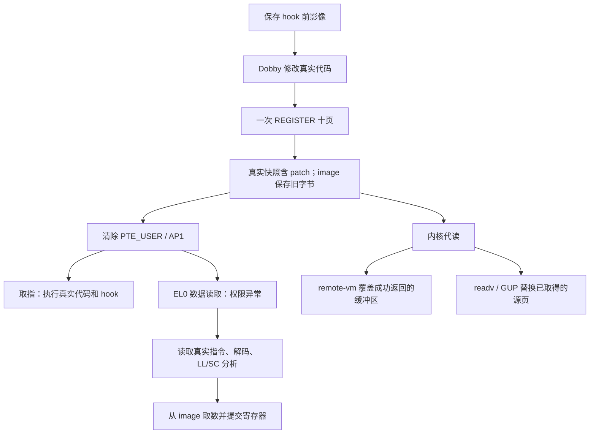

# UROV-Z 多页读取耗时分析与优化方案

分析日期：2026-11-13（客户端日期）。源码基线：`7976445`，UROV-Z 1.2.0。

**结论：优先优化每次 EL0 load 异常中的 LL/SC 指令回溯，以及回溯取指时重复进行的 VMA/页身份查找。** 当前主路径已经使用二分查找，也已经按 64 字节 LD1 读取；首先换哈希表、扩大影像窗口或优化 CRC，均无法直接消除这项重复工作。内核代读的瓶颈不同，应单独优化 syscall 批次与影像页分配。

本文交付分析与实施设计，没有修改、替换或热卸载设备上的 KPM。方案收益尚未经过修改后的 A/B 测试，不能当作已实现的加速倍数。

**现场与实测证据**

设备为 Pixel 6 / oriole、Android 16、Linux `6.1.134-android14-11-g66e758f7d0c0-ab13748739`、4 KiB 页。设备 KPM 元数据为 **1.1.0**；核对 `git diff d8d1cbe 7976445 -- module`，内核目录的唯一变化是 `urov_z.c` 中版本字符串改为 1.2.0。设备上与本地的 `libuzhost.so` SHA-256 一致：

```text
03b71648e3f6c6fc6462da4725403eb92707071dd162c5c06c08747da5265081
```

这确认了测试库和相邻版本内核源码的一致性范围；没有读取运行内核中的模块文本做逐字节比对。设备时钟为 2025-10-10，因此设备 logcat 时间不能当作本次分析的日历日期。

最初全局状态显示 `active pages=10 armed=10 hits=7910`，但旧 runner 已无 `/proc` 记录；认证 QUERY 正常回收死亡会话后，才重新运行测试。随后完成 manual 后端一轮采样测试（PID 9558）和一轮不带采样的测试（PID 9647），两轮均 `RESULT PASS`。以下使用 **不带采样** 的数据，每通道 2 次预热、9 次采样，取中位数：

| 通道 | 已 hook、未覆盖 | 十页覆盖 | 本轮前后比值 |
|---|---:|---:|---:|
| 直接 EL0 读取 + CRC | 1,881.1 µs | 682,957.3 µs | 363.06 倍 |
| process_vm_readv + CRC | 85.2 µs | 142.7 µs | 1.67 倍 |
| /proc/self/mem + CRC | 120.6 µs | 177.4 µs | 1.47 倍 |

测试范围是 **204,608 字节的整个 executable PT_LOAD**，其中只有十个 4 KiB 页被覆盖，合计 40 KiB；不是仅对 40 KiB 计时。direct 使用 LD1 + 逐位 IEEE CRC，另两路使用 zlib，proc 还计入 open/close。因此表中比值只在同一通道内比较，不能直接用 direct/readv 的横向比值代表模块加速空间。[计时实现](../integration/host.c)：`direct_range` 149 行、`crc_channel` 168 行、`benchmark` 402 行。

不带采样的四线程压力测试完成 96 次 CRC、20,480 次调用，耗时 9,693.550 ms，`mismatches=0 failures=0`。注销后的 direct 中位数变为 4,123.1 µs，表明调频、调度或温度等漂移仍然存在；微秒级差值尤其不能解释为稳定的固定开销。测试结束的全局状态为 `inactive pages=0 armed=0`，KCLF 无在途请求。

另一次 6 秒、199 Hz、仅针对测试 runner 的 cpu-clock 采样获得 1,195 个样本，丢失 0 个，**99.75% 落在内核地址范围**。内核符号地址受到限制，没有调整 `kptr_restrict`；这证明采样区间主要耗在内核，不能据此宣称“LL/SC 函数占 99.75%”。带采样测试的时间也没有混入上表。

本地证据保存在 [out/perf-analysis-20261113](../out/perf-analysis-20261113/)：`unprofiled-9647.txt`、`profiled-9558.txt`、`simpleperf-dso.txt`、`simpleperf-addresses.txt`、`perf.data`、`inspect_scan.py`、`static-scan.json`。该目录受现有 `.gitignore` 排除，不包含设备 SuperKey。

**实际实现：三条读取路径，共用影像与生命周期管理**



| 层次 | 实现与关键约束 |
|---|---|
| 入口与控制 | `module/urov_z.c` 初始化 UROV 和内置 KCLF；API 通过带 MAC 的私有 prctl 操作会话。kpatch SuperKey 与模块 API 密钥不同。 |
| 注册 | `backend.c:4341 do_register` 验证 RX 文件映射、排序页描述符、复制 image/snapshot；`1331 ap_arm_pages` 清 AP[1] 并批量刷新 TLB。全局只有一个 owner mm 会话。 |
| 用户态读取 | `3916 uz_abort_before` 接管受支持的 EL0 data permission fault；`3806 uz_emulate_load` 解码 load，拼接最多 64 字节，提交 GPR/FPSIMD、writeback 和 PC。 |
| 真实与替代视图 | `snapshot` 用于真实指令和原生语义，`image` 用于替代数据；二者不能合并。同页取指、读数据的内容可以不同。 |
| proc-mem | `4933 uz_kread_after` 在原生 helper 成功读取后改写其内核缓冲区，只处理原生实际返回的字节。 |
| readv | syscall 持有会话读者引用；`4768 uz_pin_after` 为命中的每页分配 order-0 页，复制影像并用 Linux PIN helper 替换已 pin 的原页。 |
| fast-GUP | `4994 uz_gup_after` 为支持的 FOLL_GET 读取创建独立副本；排除不适用的 PIN/LONGTERM 等情况。 |
| 更新与释放 | `readers.h` 的双 epoch 保证旧影像读者退出后再复用存储；SET_PAGE 逐页发布。fork 保存子影像，映射 hook 跟踪失效，DEACTIVATE 恢复 AP 并排空引用。 |

Linux ARM64 的 `PAGE_EXECONLY` 与 `PAGE_READONLY_EXEC` 定义也体现了这里使用的权限位差异；该后端仍须满足源码的运行时兼容性检查。[Linux 6.1 pgtable-prot.h](https://raw.githubusercontent.com/torvalds/linux/v6.1/arch/arm64/include/asm/pgtable-prot.h)

KCLF 负责注入，Dobby 负责代码修改。它们不在普通成功 load 的每次影像复制路径上。默认主影像预算 8 MiB、每页七份主缓冲，4 KiB 时最多 292 页；这首先是容量问题，不能据此推断每次 load 都复制七页。

**为什么多页会放大直接读取耗时**

1. **异常次数按读取指令计数，不按“伪造任务”计数。** 十页顺序、对齐、64 字节 LD1 扫描产生 `10 × 4096 / 64 = 640` 次受管数据读取异常。整个段内其余未覆盖区域原生读取。若改成逐字节读，同样十页会产生约 40,960 次异常。当前测试已经在 `integration/target.S:31` 使用四向量 LD1，不能再将“改成 64 字节读取”列为尚未实施的首要方案。

2. **每次普通 load 都可能重新扫描大量历史指令。** `uz_emulate_load:3843–3857` 对普通标量和向量 load 都调用 `uz_llsc_prepare`。`backend.c:141` 定义 `UZ_LLSC_PRE_SCAN=16384`，函数在 `2550` 开始，逐条向前查找 LDXR/LDXP 或清除独占状态的指令。这个上限是 16,384 条、64 KiB，不是 16,384 字节。普通 RET/BL 并不是第一轮扫描的停止条件。

   `UROV_Z_NATIVE_STEP=0` 只关闭可选的原生单步 hook；软件 LL/SC 分析、窗口模拟仍在调用链上。`llsc=0` 统计的是成功完成的相关操作，不表示扫描没有执行。

3. **取指未命中又带入线性页身份查找。** `page_find:629` 本来就是二分查找。但 `uz_read_insn:1605` 在 miss 后无条件调用 `uz_page_by_identity:997`；后者先 `find_vma`，再遍历 `g_sess.page_count` 比较文件与偏移。普通 owner 的读指令位于未注册代码页时，也会反复支付这项原本主要为子 mm 重映射准备的代价。

   这次相同 SHA 的 ELF 中，`uz_read_block` 位于相对地址 `0x768c`，第一个注册目标位于 `0x8000`。对该 ELF 静态复算第一轮扫描条件，从 `0x7688` 到 ELF 起点共 **7,587 个指令字**都没有命中停止条件。仅此区间乘以 640 次异常，就是 **4,855,680 次取指检查**；对应身份查找还会反复比较十个描述符。这是二进制静态推导，实际扫描何时在映射边界停止仍需内核计数器确认，不能将它写成已采集的运行计数。

4. **单次 load 还有可合并的重复工作。** `uz_atomic_emulate:2892` 先取一次指令并复制寄存器模型，普通 load 解码不匹配后，外层再次取指、复制模型；随后 `range_covered` 与 `read_range` 又分别找数据页。SIMD 提交还要保存、复制、更新 FPSIMD 状态。它们都是候选优化点，但应先消除上面的长扫描。

5. **并发读会争用共享计数。** 每次异常都进入/退出同一个 `g_readers` 原子字，并更新全局 hits；四线程下存在缓存行争用。它适合在长扫描优化后再量化，不能先删除读者保护换性能。

用 `F` 表示异常数，`S` 表示每次回溯指令数，`N` 表示注册页数，可将当前热点近似写成：

```text
Tdirect ≈ T原生读取与CRC
        + F × [T异常进出 + T解码/FPSIMD + T读者同步
               + S × (T取指 + T二分查找 + TVMA查找 + O(N)身份比较)]
```

当扫描 PC 一直不在注册页内，且被读取页数随 N 一起增加时，`F∝N` 与身份比较的 `O(N)` 相乘，相关部分可能呈接近平方的增长；不是所有路径天然 O(N²)。本次只有十页运行点，没有把这个复杂度推导冒充页数扫描曲线。

当前前后差值除以 640 约为 **1,064 µs/次异常**，仅是含扫描等全部附加成本的粗估，不是 ARM64 异常入口本身的固有延迟。

**建议实施顺序与具体设计**

| 优先级 | 改动位置 | 目标 | 保留的关键条件 |
|---|---|---|---|
| P0 | `uz_read_insn`、`uz_llsc_prepare` | 去掉 owner miss 的无效身份查找；批量取指；缓存静态分析结果 | 真实指令视图、child mm、代码修改失效、原 LL/SC 判定 |
| P1 | `uz_abort_before`、`uz_emulate_load` | 一次取指/分类、复用数据页定位；统计分流 | 原子指令仍受支持、跨页/FPSIMD/异常提交语义 |
| P1 | `integration/host.c` | 将代读批次从 4 KiB 扩大到 64 KiB 等实测尺寸 | 同一算法/范围比较；正确处理短读 |
| P2 | `uz_pin_after` 与影像发布 | 为 readv 使用有独立引用的不可变版本页 | 原生权限检查、PIN 计数、SET/注销时的存活引用 |
| P2 | SET_PAGE、映射与子影像索引 | 减少批量更新的重复等待，降低 child 查找成本 | 原子发布、generation 冲突、生命周期与映射一致性 |

**P0：先使普通读取不再重复做长距离分析。**

第一步，拆开 owner 与 child 的真实指令取值。对 owner，已注册地址使用自己的 native snapshot；未注册地址直接走 nofault 原生读。仅对已确认的 child 使用文件身份解析。参考结构如下，不是可直接替换全部现有代码的补丁：

```c
/* 已持有会话读者引用；省略地址/状态与子快照校验。 */
if (mm == session->mm) {
    page = page_find(page_base(pc));
    return page ? read_owner_snapshot(page, pc, out)
                : read_native_instruction_nofault(pc, out);
}
return read_child_instruction_with_identity(mm, pc, out);
```

这与 `uz_page_for_fault` 的 owner 路由原则一致，但实施时要专门核对历史上依赖同文件别名的情况，并使用子进程自己的真实快照。不能简单让 child 也根据父 VA 命中父 snapshot。异常路径中的 VMA/页表生命周期问题也不会因为增加缓存而自动解决。

第二步，将第一轮逐条 nofault 读改为 **按页边界限制的 256/512 字节块读取，块内逆序扫描**。一个异常内复用已确定的代码页/身份，不必每 4 字节重新查 VMA。保持原来的扫描上限、先后顺序和停止条件；批量读取失败时回退到必要的逐条读取，避免因较早地址不可读而错误跳过靠近 PC 的合法停止指令。异常栈只放一个小块，不能分配 64 KiB 栈缓冲，也不能在异常中进行睡眠分配。这一步可以先独立提交，不必依赖跨异常缓存。

第三步，加入有界的 **指令分析缓存**。起步可采用 256/512 槽、每 CPU 或按 task 分片的结构，并用实际 CPU 数核算内存预算。建议缓存内容分为两类：

- 已证明第一轮会返回空计划的静态结果，例如遇到 CLREX/exception，或扫描上限内没有 exclusive load。重复读取同一 PC 时直接复用“无需后续桥接”的结果。
- 找到候选 exclusive load 时，缓存它的位置和解码形态；本次寄存器回推、地址、分支入口条件和写入计划仍按当前状态重算。不能缓存上次的最终 `uz_llsc` 结构或寄存器值。

缓存键至少包括 `(session实例, mm身份, PC, mapping_epoch, native_code_epoch)`；ABI 中固定为 1 的 session 字段不能充当唯一实例编号。它是分析结果缓存，不是 reader 白名单，所有调用者继续获得相同读取规则。

必须区分 **fake image generation** 和 **真实代码版本**。SET_PAGE 通常只改 image，不能拿它单独证明 native 指令未变；只核对当前 opcode 也不足以证明前面数 KiB 指令未变。以下事件应在变化对读者可见前使依赖失效，或令该区域退回慢路径：

- mprotect 的写权限转换、mmap/MAP_FIXED、munmap、mremap、exec、会话释放；
- 模块自身实际代码写入、native replay、外部写入捕获/同步、ptrace/proc-mem/GUP 写入；
- fork/子影像建立、相关映射身份变化，以及分支目标图的更新。

现有 `g_code.seq` 不是覆盖所有实际代码修改的完整版本协议。无法可靠跟踪写入的区域不启用长期缓存；先对稳定 RX 测试路径启用，并保留完整慢路径。缓存中的指针必须受读者引用或不可变对象生命周期保护；当前 mremap 原地排序描述符的问题应一并避免，否则“最近页缓存”可能指向已经改变含义的描述符。

另外，普通非 exclusive load 在稳定的分支图状态下，如果该图已确定无效/不完整，后面的 `uz_llsc_skipped` 原本就会拒绝桥接，可以考虑把这个条件前移，避免先扫描再拒绝。必须放在 `sample->excl` 的特殊分支之后，并正确处理图的并发更新；不能据此跳过所有 exclusive load。

**不要以 `native_step=0` 为条件一并删除软件桥接，也不要直接把 16,384 改成 64。** 这样可能改变 `LDXR → 普通读取 → STXR` 的结果或重试行为。若实验明确排除这类序列，可以另设计显式的能力/策略选项，但它是功能范围变化，不能作为保持当前语义的默认优化。

**P1：降低一次异常的固定成本。**

- 在入口只读取一次真实 opcode；先分类普通 load、LSE atomic 和其他路径，把同一 opcode/寄存器上下文传给后续处理，避免普通 load 先完整尝试 atomic 路径再重来。不能因为 ESR 显示 read 就排除实际读改写指令。
- 解码缓存只保存静态形态。有效地址、writeback、符号扩展、目标寄存器和安全校验仍基于本次现场；跨页保持最多两个片段的完整检查，全部成功后才提交。
- 对单页命中复用 FAR 已定位的描述符，在解码地址验证后避免 `range_covered + read_range` 重复查找；跨页保留通用路径。
- 首先将纯统计 hits/replays 等改为可安全聚合的分片计数。`g_readers` 是释放安全协议，不应机械替换成无保护的 per-CPU 自增；readv 还跨越可睡眠 syscall 和迁移，需另行设计引用 token 与关门/排空协议。
- FPSIMD 使用 Linux helper 的契约继续保留，不直接用内核 NEON 写 V0–V3 省掉状态管理。Linux 对 task/CPU 所有权和延迟恢复有专门协议。[Linux 6.1 fpsimd.c](https://raw.githubusercontent.com/torvalds/linux/v6.1/arch/arm64/kernel/fpsimd.c)

优化长扫描以后，再实测 LDR、LDP X、LDP Q、LD1 的单位字节成本。LDP X 可以减少向量状态操作，但相同字节量会产生更多异常；不能预先断言哪一种更快。

**P1/P2：内核代读单独处理。**

当前 `crc_channel` 使用 4,096 字节缓冲，204,608 字节需要 50 次 readv/pread 调用。改成预分配并预触页的 64 KiB 缓冲，可以把用户态调用数降为 4；内存分配放在计时区间外，循环处理合法短读与错误。对于 proc，可以另外提供 fd 复用模式，但应同时保留原先含 open/close 的端到端指标。

这不等于把所有内核工作都减少到四次。`process_vm_readv` 内部仍分批 pin/copy/unpin，`/proc/pid/mem` 的 `mem_rw` 内部仍用 PAGE_SIZE 临时缓冲循环调用访问 helper；扩大用户态缓冲主要减少 syscall 边界成本。[Linux 6.1 process_vm_access.c](https://raw.githubusercontent.com/torvalds/linux/v6.1/mm/process_vm_access.c)、[Linux 6.1 fs/proc/base.c](https://raw.githubusercontent.com/torvalds/linux/v6.1/fs/proc/base.c)

`uz_pin_after` 目前对每次命中的每一页执行 `vmalloc_to_page → alloc_pages → copy_highpage → grab(PIN) → put/unpin`。重复读同一代影像时，这些新分配和整页复制可以进一步减少，推荐仅先用于已验证的 readv 只读消费路径：

1. REGISTER/SET 时为影像创建独立 order-0、发布后不可变的版本页；版本对象持有正常页引用。
2. 保留原生远端访问权限检查和成功 pin 的结果；after-hook 命中后，对当前影像版本用正确 PIN helper 取得调用者 pin，再释放原生 pin 并替换返回槽。
3. syscall 原生 unpin 归还这次 pin；SET 发布新的版本页，旧版本在模块读者离开后释放模块的普通引用。只要尚有外部 pin，旧页就继续存活；最后一个引用释放后再由内核回收。
4. 不把仍有 pin 的旧页回收为 spare，不对已发布页原地写。实际代码写入/外部同步也必须创建新版本或退回当前独立副本路径；限制被保留的旧版本总内存。

当前 arena 中的 image/spare 会交换和复用，**直接把 `p->image` 对应页交给 readv 并不足以实现上述协议**。普通 GUP 的 GET 引用和 readv 的 PIN 计数也不能混用。Linux 文档明确区分这些接口与引用方式。[pin_user_pages 文档](https://docs.kernel.org/core-api/pin_user_pages.html)

fast-GUP 的消费者范围更广，不应直接复用共享不可变页方案；先保留每次独立副本，直到确认消费者不会修改或长期持有共享内容，并完成引用生命周期验证。简单空闲页池也缺乏可靠的外部归还通知，不能只在 hook 返回时就回收。

proc-mem 当前是在原生读取成功后再覆盖，仍有原数据复制成本。不要用 before-hook 直接返回 image 来跳过原生访问控制、VMA 检查和短读语义；先优化无交集快速返回与每次 buffer 内的页查找。

**P2：注册、更新和多页索引。**

REGISTER 的 `uz_code_build` 扫描 executable VMA，是注册/映射变化成本，应单独计时；不是每次 CRC 都重建整张图。当前十页已经一次 REGISTER，`ap_arm_pages` 也已在页循环之后批量 flush，一般成功读取路径不会为每次 load 做全局 TLBI。以“把每次读的 TLB 刷新合并”为主方案不符合当前代码。

批量 SET_PAGE 场景可扩展单次事务：先验证所有页并准备新影像，通过不可变描述符/版本根发布，再做一次 epoch 切换和旧读者等待。当前 `drain_readers` 在有残留读者时使用 `msleep(1)`；连续 N 次 SET_PAGE 可能放大等待，不能改为异常上下文忙等。事务一致性须另行定义，不能声称一次跨多条指令的 CRC 因此自动得到同一版本。

owner 的页索引已是二分，先修复每次取指的身份遍历。若修复后大页数查找仍显著，再考虑稳定页 ID、最近页缓存或按 VPN 的索引；child 可使用 `(mm, file, pgoff)` 索引和 `(mm, page_id)` 快照索引。索引必须与映射版本同时发布，避免直接缓存现有可原地移动的结构。

仅缩小 `fake_len` 不能消除所在页其他数据读取的 AP 异常。应只注册实际需要覆盖的页；当前测试已经如此。减少页表操作的进一步工作应先满足原生 PTL/VMA 生命周期协议，不能靠删 TLBI 或取消同步获得表面收益。

**验证计划与验收条件**

实施前增加可关闭的诊断计数：普通 load 次数、扫描调用与指令字数、分析缓存 hit/miss/invalidations、identity 查找次数与比较数、nofault 取指次数、PIN 复制/分配字节数、读者 CAS 重试数。时间采样使用低频抽样，避免每条指令计时或输出日志本身成为瓶颈。诊断版用于归因，关闭诊断后的版本用于最终延迟比较。

| 维度 | 测试安排 |
|---|---|
| 分离注册规模与读量 | 固定只读一页，改变注册页数；再固定注册上限，改变实际扫描页数，分清查找规模和异常次数。 |
| 页数 | 1、2、4、8、10、32、64、128、256，按 QUERY 容量裁剪；16 KiB 设备不能直接沿用 4 KiB 的 292 页预算。 |
| 读取宽度 | 1、8、16、32、64 字节，以及跨页、同页取指/读数据。 |
| 读取路径 | direct、readv、proc；读取并复制到普通缓冲区的时间，与缓冲区 CRC 时间分别记录，再保留原端到端指标。 |
| 并发与漂移 | 1/2/4 线程；固定相同 CPU/亲和性策略，记录温度与频率；交替 off/on 次序，预热后收集足够样本计算 P50/P95。 |
| 缓存正确性 | 正/负缓存命中后分别修改前置指令、当前 opcode、映射和子快照；覆盖 SET、外部写入、重新映射、fork 和注销，防止缓存旧地址或旧计划。 |
| 指令与生命周期 | 原有 73 项和核心自检、LL/SC 长窗口与分支跳入负例、LSE、SIMD、跨页失败、活动 readv 与 SET/注销并发、vmsplice 延迟释放/分配失败。 |

第一阶段的结构性验收是：普通 owner 在未注册代码页取指时不再做 page_count 次身份比较；同一稳定 PC 热身后不再每次重复数千条扫描。64 字节、十页的直接扫描仍约 640 次异常，但每次异常的处理时间应明显下降。第二阶段才以 pin 分配次数、字节数和延迟判断不可变影像页是否值得实施。

目前没有优化版设备结果，也没有页数/宽度完整矩阵，不能承诺从 683 ms 降到某个具体值。理论上 PAGE_AP 仍保留每条受管 load 的异常与寄存器提交成本；缓存能消除重复分析，不能消除这个机制本身。

如果最终要求任意直接读取都接近原生速度，就需要重新评估执行与数据视图的架构，例如原地址保留可读影像、真实执行迁往重定位代码。那会引入执行入口异常、PC 相对指令、控制流、PAC/BTI、同页读取和生命周期等另一组问题，属于独立后端设计，不应与当前实现的性能修补混为一个小改动。
